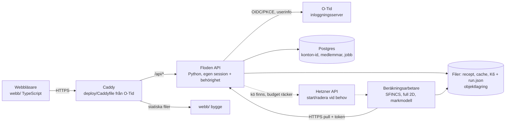

# Arkitektur för drift: konton och server framför beräknings-API:t

Status: **förslag** (2026-11-21). Inga beslut är fattade här; de står i `BESLUT.md` och fattas av Joel.
Källa för det som återanvänds: O-Tid (github.com/joelberring/otid, MIT, © 2026 Joel Berring), läst vid commit `1d63297`.

## 1. Läget i dag

### Floden

| Del | Fakta |
| --- | --- |
| API | `src/webb/api.py`: stdlib `ThreadingHTTPServer` på `127.0.0.1:8765`, ett `threading.Lock` runt körningarna, 25 MB-spärr på `Content-Length`. Ingen inloggning, ingen behörighet. |
| Klient | `webb/` (TypeScript, Vite, MapLibre); Vite proxar `/api/*` till Python-API:t. |
| Lagring | Bara filer: recept + cache (K1/K2), resultat (K6) med manifest `run.json` (K0). Ingen databas. |
| Tunga körningar | Full 2D (`src/tvad/`, SFINCS som extern binär) och markmodell på stora ytor körs i samma process. Öppna beslut: GPU-leverantör, server för SFINCS. |
| Datakrav (`AGENTS.md`, `docs/DATA.md`) | Inga personuppgifter i repo, loggar eller prompter. Ledningsdata kan vara skyddsklassade: lämnar aldrig lokal miljö/stadens miljö. Stadens baskarta och tätare laser är interna. |

### O-Tid

| Del | Fakta |
| --- | --- |
| Konton | `packages/database/src/schema/accounts.ts`: `user_account`, lösenordsverifierare (scrypt, `packages/application/src/user-account.ts`), sessioner med hashad hemlighet + CSRF (`user_account_session`, kakor `__Host-otid-organizer-*` i `apps/web/src/lib/organizer-account-cookies.ts`), spärrar med HMAC av IP (`account-throttle.ts`), återställning och e-postbekräftelse, Google OIDC med PKCE (`google-*.ts`, ADR-0205). |
| API | `apps/web/src/app/api/account/*` (profil, namn, lösenord, återställning, Google, logga ut överallt, ta bort, lagring, kartkällor, AI-kopplingar). |
| OAuth-server | `packages/application/src/oauth.ts` + `apps/web/src/app/api/oauth/{register,authorize,token,revoke}`, `.well-known/oauth-authorization-server`: OAuth 2.1, PKCE S256, dynamisk registrering (RFC 7591), nycklar sparas bara som sha256, roterande förnyelsenyckel. Scopes i dag: `kartprojekt`, `banlaggning`. Nyckeln kontrolleras med databasuppslag (`authenticateOauthAccess`); det finns ingen introspektions- eller userinfo-ändpunkt. |
| Drift | `docker-compose.prod.yml` + `deploy/`: Caddy med automatisk HTTPS, HSTS och uttryckliga body-gränser per sökväg (`deploy/Caddyfile`); Postgres 17 med roller ägare/app/utskrift (`deploy/db-roles.sh`, ADR-0186); dump varje timme + restic utanför servern (`deploy/backup.sh`); färdiga avbildningar från ghcr.io efter grön CI (ADR-0195); veckorapport och larm (`deploy/monitor.sh`, ADR-0216). |
| Beräkningsarbetare | Geo-arbetaren (ADR-0219 K5/K5b): `scripts/geo-worker.ts` i avbildningen `deploy/geo.Dockerfile`, **pull-kö över HTTPS med token** (inga öppna portar), servern skapas hos Hetzner när jobb väntar och raderas efter tomgång (`packages/application/src/geo-server.ts`, `apps/web/src/lib/geo-server-runner.ts`): budget per månad, högst 3 starter/timme, högst N timmar per server, okända servrar med etiketten raderas. |

### Hur hårt sitter O-Tids konton ihop med tävling och klubb?

Hårt. Kontokoden är inte ett eget paket:

- `schema/accounts.ts` importerar `events` och `races`; samma fil har `event_administration_grant` m.fl.
- `user_account` har O-Tid-specifika fält: `map_quota_mb`, `geo_tiles_per_month`, `guest_expires_at`.
- Varje inloggning går genom `acceptOnLogin` (`account-arrival.ts`): inbjudningar till tävlingar och klubbarnas medlemslistor från Eventor (ADR-0205 beslut 6).
- Att ta bort ett konto (`account-self-service.ts`) tar bort ägda tävlingar (`deleteAccountWithOwnedEvents`), kartprojektens spår, OAuth-kopplingar och områdestilldelningar.
- En migrationskedja för allt (`packages/database/migrations`, 0000–0131): kontotabellerna går inte att migrera för sig.
- `packages/application` är ett paket (ca 44 000 rader) där konton, tävlingar, kartor och geo-jobb importerar varandra.

## 2. Tre alternativ för konton

| | (A) O-Tid som inloggningsserver | (B) Eget kontopaket ur O-Tid + TS-gateway | (C) Porta till Python |
| --- | --- | --- | --- |
| Vad | Floden blir OAuth 2.1/PKCE-klient mot O-Tids befintliga server, ny scope `floden`. Ingen kontokod kopieras. | Konton, sessioner, scrypt, spärrar, Google lyfts ut till ett paket (t.ex. `konton/`) med källhänvisning; en tunn Node-gateway framför Python-API:t. | Samma funktioner skrivs om i Python inne i Flodens API. |
| Kod att skriva | Liten: i O-Tid scope + introspektion/userinfo; i Floden klientflöde, egen session och egen behörighetstabell. | Stor: lösgöra kontot från `events`/`races`/Eventor/kvoter, ny migrationskedja, gateway, tester. | Störst: allt från början, plus samma säkerhetsgranskning som O-Tid redan gjort (ADR-0186, 0189, 0205). |
| Säkerhet | Bevisad kod (OAuth, PKCE, sha256-nycklar, rotation) används som den är. | Bevisad kod, men omflyttad: risk att något skydd tappas i lyftet. | Ny kod = nya fel; ingen återanvändning av O-Tids granskning. |
| Skilda användare (BESLUT) | Planerare på staden och klubbmedlemmar delar kontodatabas. Floden ser bara ett konto-id + namn + e-post. | Helt skilda databaser. | Helt skilda databaser. |
| Beroende | Floden kan inte logga in när O-Tid ligger nere; O-Tids drift blir Flodens. | Inget driftberoende. Två kopior av kontokoden att hålla säkra. | Inget beroende, men ensamt underhåll. |
| Stadens miljö | Svår att motivera om Floden körs hos staden: inloggning via en privat klubbtjänst. | Fungerar, men staden vill troligen ha sin egen IdP (Entra ID) ändå. | Som (B). |
| Licens | Ingen kod lånas. | MIT → GPL v3 går, MIT-notisen bevaras. | Ingen kod lånas. |

## 3. Rekommendation

**(A) nu, byggt som en generell OIDC/OAuth-klient i Floden – inte som en O-Tid-integration.** Inte (B) eller (C).

- **BESLUT 2026-11-20 "Eget repo … delar lyfts ut som paket":** kontokoden är inte en avgränsad del (avsnitt 1); att lyfta den kräver att O-Tids domän skärs isär. Det mönster som går att återanvända är OAuth-servern, och den kan användas utan att kopieras.
- **Olika användare:** Floden lagrar inga lösenord och inga O-Tid-data. Floden har en egen liten tabell `medlem(konto_id, projekt/område, roll)`, så behörighet per projekt och provområde ligger i Floden.
- **Byt IdP senare:** klienten pratar standard (OIDC discovery, PKCE, `sub`/`email`). Ska Floden köras hos staden pekar man om den mot stadens IdP (Entra ID) utan kodändring; O-Tid är bara första IdP:n.
- **Säkerhetskrav ur `AGENTS.md`:**
  - Loggar: bara konto-id (uuid) och jobb-id, aldrig e-post eller namn; inga indata i loggar.
  - Ledningsdata och stadens interna data laddas aldrig upp till den publika servern. De körs lokalt eller i stadens miljö (samma Floden, egen instans, egen IdP). Servern tar bara öppna data och påhittade projekt tills avtal finns.
  - Behörighet kontrolleras i Python-API:t per projekt/område vid varje anrop, inte bara vid inloggning.
  - Resultat och recept är filer med `run.json` (K0); databasen innehåller inga beräkningsresultat.

Ändringar som krävs i O-Tid (eget arbete där, egen ADR):

1. Scope `floden` i `OAUTH_SCOPES`, och Floden som förregistrerad konfidentiell klient (inte dynamisk registrering).
2. En `userinfo`- eller introspektionsändpunkt (RFC 7662) så att Floden kan kontrollera nyckeln utan att läsa O-Tids databas.
3. Spärrade konton och återkallade kopplingar gäller direkt (finns redan i `authenticateOauthAccess`).

## 4. Drift

| Del | Återanvänds från O-Tid | Anpassning för Floden |
| --- | --- | --- |
| Caddy | `deploy/Caddyfile`: HTTPS, HSTS, zstd/gzip, body-gränser per sökväg | Gränser för LAZ (rutor ca 50–200 MB), DWG (≤ 80 MB som O-Tid), GeoTIFF/LandXML. Python-API:ts 25 MB-spärr höjs bara för de uppladdningssökvägarna. Valfritt `forward_auth` mot API:ts sessionskontroll för statiska resultatfiler. |
| Avbildningar | ADR-0195: bygg i GitHub Actions efter grön CI, hämta från ghcr.io, `TAG` låser version | En avbildning för API + webb, en för arbetaren (SFINCS, PDAL, lasclip, dwgread). |
| Postgres | Version låst, roller ägare/app (ADR-0186, `db-roles.sh`) | Bara konto-id, medlemskap, jobb och kö. Liten databas → enkel backup. |
| Backup | `deploy/backup.sh`: timdump + restic utanför servern | Dump av Postgres + restic av recept/resultat. Cachad öppen data säkerhetskopieras inte (kan hämtas igen). |
| Bevakning | `deploy/monitor.sh`, ADR-0216 | Disk (resultat växer), köns ålder, arbetarens budget. |
| Server (API) | Vanlig VPS (ADR-0168) | API:t räknar bara graf och hybrid (sekunder). Allt tyngre går till arbetaren. |

### Beräkningsarbetaren (geo-arbetarens mönster)

- **Passar bra:** pull-kö över HTTPS med token (inga öppna portar), en körning = ett jobb med indata-sha256 → samma `run.json`, servern raderas efter tomgång, månadsbudget, högst några starter per timme.
- **Jobbtyper:** `full2d` (SFINCS), `markmodell` (laser → K1 för många rutor), `ensemble` (stora ensembler). Graf och hybrid stannar i API:t.
- **Kopplat till öppna beslut:**
  - *Server för SFINCS-binär:* arbetarens avbildning bygger SFINCS ur källkoden vid låst version (som Karttapullautin i `geo.Dockerfile`).
  - *GPU-leverantör:* samma kö fungerar med en GPU-maskin. Hetzner har GPU bara som dedikerade servrar (inte per timme); för GPU per timme krävs en annan leverantör. Kön behöver inte ändras, bara "starta/radera"-delen.
- **Skillnad mot O-Tid:** jobben får bara öppna data och påhittade lappar. Ingen ledningsdata och inga interna stadsdata till en molnarbetare (AGENTS.md).

## 5. Beräkningsservern: starkare men mer sällan (hela Stockholm)

Joel 2026-11-21: Flodens beräkningsserver blir troligen **starkare** än O-Tids geo-server men körs **mer sällan** (batch, inte ständigt på). Serverlösningen sätts upp senare, "lite O-Tid men anpassad för dessa uppgifter". Minst en körning ska omfatta **hela Stockholm**; provområdet (ca 1 km²) kommer först.

**Alla siffror nedan är uppskattningar** för att dimensionera, inte mätvärden. De ska ersättas med mätningar (AGENTS.md: mät innan du påstår).

### Storlek (uppskattning)

Antagande: Stockholms kommun ca **190 km² land**. K1-ruta 500 × 500 m med 25 m överlapp på varje sida (550 × 550 m beräknat), 0,25 m celler.

| Storhet | Per ruta | Hela staden |
| --- | --- | --- |
| Rutor | 1 | ca **760** (190 / 0,25 km²) |
| Celler | 2 200 × 2 200 ≈ **4,8 milj.** | ca **3,7 miljarder** (med överlapp) |
| K1 okomprimerat: `mark` f32 + `osakerhet` f32 + `markslag` u8 = 9 B/cell | ca **44 MB** | ca **33 GB** |
| K2 `cell_till_nod` i64 (8 B/cell) | ca 39 MB | ca 29 GB |
| K6 fem f32-raster (djup, hastighet, fara, två tider) | ca 97 MB | ca 74 GB |
| Komprimerat (COG, mycket NaN/konstant) | troligen 1/3–1/2 av ovan | ca **50–70 GB** per fullständig körning |
| Laser (Lantmäteriet, 1–2 p/m², LAZ) | – | ca 200–400 milj. punkter, några GB |
| Arbetsminne per ruta (markmodell, sänkgraf) | ca **1–3 GB** | – |

### Vad som går att dela upp

- **Markmodell (T01) och sänkgraf (T02) är rutvisa:** en ruta per jobb i pull-kön, helt parallellt. Uppskattat några minuter per ruta → ca 25–75 CPU-timmar för staden, dvs. **ca 1–2 timmar på en maskin med ca 48 kärnor**.
- **Global rutgränssammansättning (T02)** är ett eget, litet steg efter rutorna (bara noderna längs skarvarna), körs en gång på en maskin.
- **Graf-dynamik och ensemble (T03)** på hela sänkgrafen: sekunder–minuter, ryms på en maskin.
- **Full 2D/SFINCS för hela staden är det tunga:** 0,25 m rakt av går inte. Med subgrid (0,25 m) och beräkningsnät 2–4 m blir det ca 12–50 milj. beräkningsceller; ett 6 h-regn med efterförlopp kräver tiotusentals tidssteg. Uppskattat **flera timmar på många kärnor eller en GPU**, upp till ett dygn på CPU vid 2 m. Delas i avrinningsområden där sänkgrafen visar att de inte påverkar varandra.

### Förslag: stora maskiner vid behov, med budgettak

- **En körning = ett batchjobb:** kön fylls (760 markmodellrutor, sammansättning, ensemble, 2D-delområden), en stor maskin startas, tömmer kön och raderas. Inget står på mellan körningarna.
- **Maskintyp:** dedikerad CPU (t.ex. Hetzner CCX med ca 48 kärnor och ca 192 GB minne) för markmodell, sänkgraf och 2D på CPU. GPU-leverantör för 2D är en **öppen fråga** (Hetzner har GPU bara som månadshyrda dedikerade servrar).
- **Budgettak per körning och per månad**, kontrolleras före start och under körningen (som `OTID_GEO_BUDGET_EUR_PER_MONTH`), plus högsta antal timmar per maskin. Pris per timme läses från leverantören, inte hårdkodat.
- **Uppskattad kostnad** för en hel stad (CPU, några timmar på en stor maskin): storleksordningen tiotals euro per körning. Ska mätas på provområdet och skalas upp innan det sägs något bindande.

### Skillnad mot O-Tids geo-server

| | O-Tid geo-server | Flodens beräkningsserver |
| --- | --- | --- |
| Användning | Ofta, små jobb (≤ 16 laserrutor), 4 GB räcker | Sällan, stora batcher, ca 48 kärnor / ca 192 GB eller GPU |
| Avbildning | Node + Karttapullautin + lasclip + dwgread | Python + GDAL/rasterio + PDAL + lasclip + dwgread + SFINCS (byggd ur källkod vid låst version); **ingen Karttapullautin** |
| Lagring | Resultatfiler skickas tillbaka och rensas | Rutcache och recept (K1/K2 med sha256) **sparas** mellan körningar; bara ändrade rutor räknas om. Resultat (K6 + `run.json`) som filer i objektlagring |
| Indata | Lantmäteriets laser med kontots egna uppgifter | Bara öppna data och påhittade lappar på molnmaskinen; interna stadsdata och ledningsdata aldrig |
| Start | Ett väntande jobb startar en server | En **körning** (beställd av en behörig person, med kostnadsuppskattning) startar maskinen |

## 6. Steg i ordning

| # | Steg | Visas med | Omfattning |
| --- | --- | --- | --- |
| 1 | Docker Compose lokalt: Caddy + Floden API + webb, utan inloggning | `https://localhost` visar webbklienten | ½ dag |
| 2 | Floden: generell OIDC-klient (PKCE), egen session (hashad hemlighet + CSRF som O-Tid), `medlem`-tabell, behörighet per område i API:t | Test: utan session 401, fel område 403 | 2–3 dagar |
| 3 | O-Tid: scope `floden`, förregistrerad klient, userinfo/introspektion (egen ADR i O-Tid) | Logga in i Floden med O-Tid-konto lokalt | 1–2 dagar |
| 4 | Jobbkö i Floden (Postgres) + arbetare som tar `full2d` över HTTPS med token | A1/EA1 körs via kön och ger samma `run.json` som lokalt | 2 dagar |
| 5 | Avbildningar i CI (ghcr.io), backup och bevakning från `deploy/` | Grön CI bygger två avbildningar; dump + återställning provad | 1–2 dagar |
| 6 | Arbetare vid behov (Hetzner: start/radera, budget, tomgång) | Väntande jobb startar en server som raderas efter tomgång | 2 dagar |
| 7 | Mät provområdet (1 km²): tid, minne och disk per ruta, 2D-tid per km² | Mätvärden i `STATUS.md` som ersätter uppskattningarna i avsnitt 5 | ½ dag |
| 8 | Batchkörning på stor maskin: kö för hela staden, rutcache, budgettak per körning | En stadsdel (t.ex. Hägersten-Älvsjö) körd i en batch | 2–3 dagar |
| 9 | Hela Stockholm (markmodell + sänkgraf + graf-dynamik, sedan 2D per delområde) | Karta över hela staden med `run.json` | beror på steg 7–8 |
| 10 | (Senare) Byt IdP till stadens om Floden körs hos staden | Inloggning med stadens konto | beror på staden |

## 7. Beslut som Joel behöver fatta

1. **Konton:** (A) O-Tid som inloggningsserver med generell OIDC-klient, (B) eget kontopaket, eller (C) Python-port.
2. **Var Floden körs först:** egen VPS (öppna data, påhittade projekt) eller stadens miljö (då stadens IdP och inga externa tjänster).
3. **Delad eller egen server med O-Tid:** samma VPS är billigare men gör att en Floden-körning kan störa en tävling. Förslag: egen server.
4. **GPU och SFINCS:** leverantör för arbetaren (Hetzner CPU per timme först; GPU-leverantör senare), och budget per månad.
5. **Lagring av resultat:** lokal disk eller objektlagring (O-Tid ADR-0224), och hur länge resultat sparas.
6. **Vem får konto:** öppen registrering, inbjudan per projekt, eller bara konton som Joel lägger till.
7. **Beräkningsserver för stora batcher:** maskintyp (dedikerad CPU, ca 48 kärnor), budgettak per körning och per månad, vem som får beställa en körning.
8. **Hela Stockholm:** när (efter mätning på provområdet), vilken data (bara Lantmäteriets öppna laser och öppen baskarta, eller stadens interna – då i stadens miljö), och vilken 2D-upplösning.

## 8. Licens

- O-Tid är MIT. MIT-kod får tas in i Flodens GPL v3-kärna om upphovsrätts- och licensnotisen bevaras (i filhuvud eller `tools/<namn>/KALLA.md`).
- LibreDWG (`dwgread`) och SFINCS är GPL-3 och körs som separata program i arbetarens avbildning, byggda oförändrade ur källkod vid låst version.
- Karttapullautin ingår i O-Tids geo-avbildning men **används inte i Floden** (BESLUT 2026-11-20). Arbetarens avbildning byggs därför ny för Floden; bara mönstret (pull-kö, token, start/radera) och byggstegen för lasclip och dwgread tas över.
