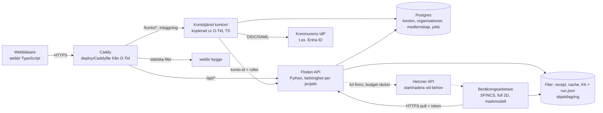

# Arkitektur för drift: konton och server framför beräknings-API:t

Status: **förslag** (2026-11-21, uppdaterad samma dag efter Joels inriktning i avsnitt 0). Inga beslut är fattade här; de står i `BESLUT.md` och fattas av Joel.
Källa för det som återanvänds: O-Tid (github.com/joelberring/otid, MIT, © 2026 Joel Berring), läst vid commit `1d63297`.

## 0. Ny inriktning (Joel 2026-11-21)

> "floden ska ha en egen server tror jag. kopiera otids system med ingen eventor-koppling. kommuner är
> användare så jag tänker att sso-inloggningar bör fungera på sikt."

- **Egen server** för Floden, skild från O-Tids.
- **O-Tids kontosystem kopieras och skalas av** (variant av alternativ B, avsnitt 2): ingen delad inloggning med O-Tid, ingen Eventor.
- **Användarna är kommuner:** organisation → förvaltning → projekt (avsnitt 3a), SSO på sikt (avsnitt 3b), automatisk koppling till förvaltning (avsnitt 3c).
- Rekommendationen i avsnitt 3 är ändrad efter detta. Förslag till beslutsrader står i avsnitt 7; `BESLUT.md` ändras bara av Joel.

## 0b. Geografi först (Joel 2026-11-23)

Systemdesignens avsnitt 2.0 (`design/floden-systemdesign.md`, Joels projektdokument; finns inte i repot) och serverplanen
(`design/server-och-drift.md`) ger ordningen **geografi först**: ett projekt byggs inte direkt ur en kommun, utan i en
**geografi** som mappats i förväg.

- **Geografi** = giltig kärna (några hundra meter till några kilometer) + buffert + förberäknade lager, ett objekt med id och
  version (`goteborg-test@v1`), innehållsadresserat och beskrivet av ett manifest (kontrakt **K46**, `docs/DATAKONTRAKT.md`).
  Bufferten är den större av dagsljusets påverkansradie (`H / tan 5°`) och hela tillrinningsområdet uppströms kärnan
  (ur höjdmodellen). Lager med samma innehåll lagras en gång, även om flera versioner delar dem.
- **Mappning** är en egen åtgärd, `floden geografi mappa <id> --konto <superadmin>`: bara superadmin (organisationsadmin är
  ett öppet förslag), kontots egen Lantmäteri-nyckel, bara öppna data på servern.
- **Projekt** väljer en avgränsning i en geografi (`floden projekt skapa --geografi <id>@<version> --avgransning ...`) och
  låser versionen. Avgränsning utanför kärnan ger en varning, inte ett fel. Projektet registreras i kontoregistret med
  skaparen som `utredare`.
- **Scenario som diff:** ett ritat hus (K9) är en diff mot geografin i projektet; skyfall och dagsljus räknas för nuläget och
  för scenariot. Planerat läge (beslutade planer som blir nästa bas) förbereds i datamodellen med fältet `status` på
  scenariot (`forslag`, `planerat`) men räknas inte som bas än.
- **Ordning:** S5 mappa `goteborg-test`, S6 mät den, S7 Hägersten-Älvsjö med Skärholmen, S8 hela Stockholm (`PLAN.md`).
  Stegen 8-10 i avsnitt 6 följer samma ordning.

## 1. Läget i dag

### Floden

| Del | Fakta |
| --- | --- |
| API | `src/webb/api.py`: stdlib `ThreadingHTTPServer` på `127.0.0.1:8765`, ett `threading.Lock` runt körningarna, 25 MB-spärr på `Content-Length`. Ingen inloggning, ingen behörighet. |
| Klient | `webb/` (TypeScript, Vite, MapLibre); Vite proxar `/api/*` till Python-API:t. |
| Lagring | Bara filer: recept + cache (K1/K2), resultat (K6) med manifest `run.json` (K0). Ingen databas. |
| Tunga körningar | Full 2D (`src/tvad/`, SFINCS som extern binär) och markmodell på stora ytor körs i samma process. Öppna beslut: GPU-leverantör, server för SFINCS. |
| Datakrav (`AGENTS.md`, `docs/DATA.md`) | Inga personuppgifter i repo, loggar eller prompter. Ledningsdata kan vara skyddsklassade: lämnar aldrig lokal miljö/stadens miljö. Stadens baskarta och tätare laser är interna. |

### O-Tid

| Del | Fakta |
| --- | --- |
| Konton | `packages/database/src/schema/accounts.ts`: `user_account`, lösenordsverifierare (scrypt, `packages/application/src/user-account.ts`), sessioner med hashad hemlighet + CSRF (`user_account_session`, kakor `__Host-otid-organizer-*` i `apps/web/src/lib/organizer-account-cookies.ts`), spärrar med HMAC av IP (`account-throttle.ts`), återställning och e-postbekräftelse, Google OIDC med PKCE (`google-*.ts`, ADR-0205). |
| API | `apps/web/src/app/api/account/*` (profil, namn, lösenord, återställning, Google, logga ut överallt, ta bort, lagring, kartkällor, AI-kopplingar). |
| OAuth-server | `packages/application/src/oauth.ts` + `apps/web/src/app/api/oauth/{register,authorize,token,revoke}`, `.well-known/oauth-authorization-server`: OAuth 2.1, PKCE S256, dynamisk registrering (RFC 7591), nycklar sparas bara som sha256, roterande förnyelsenyckel. Scopes i dag: `kartprojekt`, `banlaggning`. Nyckeln kontrolleras med databasuppslag (`authenticateOauthAccess`); det finns ingen introspektions- eller userinfo-ändpunkt. |
| Drift | `docker-compose.prod.yml` + `deploy/`: Caddy med automatisk HTTPS, HSTS och uttryckliga body-gränser per sökväg (`deploy/Caddyfile`); Postgres 17 med roller ägare/app/utskrift (`deploy/db-roles.sh`, ADR-0186); dump varje timme + restic utanför servern (`deploy/backup.sh`); färdiga avbildningar från ghcr.io efter grön CI (ADR-0195); veckorapport och larm (`deploy/monitor.sh`, ADR-0216). |
| Beräkningsarbetare | Geo-arbetaren (ADR-0219 K5/K5b): `scripts/geo-worker.ts` i avbildningen `deploy/geo.Dockerfile`, **pull-kö över HTTPS med token** (inga öppna portar), servern skapas hos Hetzner när jobb väntar och raderas efter tomgång (`packages/application/src/geo-server.ts`, `apps/web/src/lib/geo-server-runner.ts`): budget per månad, högst 3 starter/timme, högst N timmar per server, okända servrar med etiketten raderas. |

### Hur hårt sitter O-Tids konton ihop med tävling och klubb?

Hårt. Kontokoden är inte ett eget paket:

- `schema/accounts.ts` importerar `events` och `races`; samma fil har `event_administration_grant` m.fl.
- `user_account` har O-Tid-specifika fält: `map_quota_mb`, `geo_tiles_per_month`, `guest_expires_at`.
- Varje inloggning går genom `acceptOnLogin` (`account-arrival.ts`): inbjudningar till tävlingar och klubbarnas medlemslistor från Eventor (ADR-0205 beslut 6).
- Att ta bort ett konto (`account-self-service.ts`) tar bort ägda tävlingar (`deleteAccountWithOwnedEvents`), kartprojektens spår, OAuth-kopplingar och områdestilldelningar.
- En migrationskedja för allt (`packages/database/migrations`, 0000–0131): kontotabellerna går inte att migrera för sig.
- `packages/application` är ett paket (ca 44 000 rader) där konton, tävlingar, kartor och geo-jobb importerar varandra.

## 2. Tre alternativ för konton

| | (A) O-Tid som inloggningsserver | (B) Eget kontopaket ur O-Tid + TS-gateway | (C) Porta till Python |
| --- | --- | --- | --- |
| Vad | Floden blir OAuth 2.1/PKCE-klient mot O-Tids befintliga server, ny scope `floden`. Ingen kontokod kopieras. | Konton, sessioner, scrypt, spärrar, Google lyfts ut till ett paket (t.ex. `konton/`) med källhänvisning; en tunn Node-gateway framför Python-API:t. | Samma funktioner skrivs om i Python inne i Flodens API. |
| Kod att skriva | Liten: i O-Tid scope + introspektion/userinfo; i Floden klientflöde, egen session och egen behörighetstabell. | Stor: lösgöra kontot från `events`/`races`/Eventor/kvoter, ny migrationskedja, gateway, tester. | Störst: allt från början, plus samma säkerhetsgranskning som O-Tid redan gjort (ADR-0186, 0189, 0205). |
| Säkerhet | Bevisad kod (OAuth, PKCE, sha256-nycklar, rotation) används som den är. | Bevisad kod, men omflyttad: risk att något skydd tappas i lyftet. | Ny kod = nya fel; ingen återanvändning av O-Tids granskning. |
| Skilda användare (BESLUT) | Planerare på staden och klubbmedlemmar delar kontodatabas. Floden ser bara ett konto-id + namn + e-post. | Helt skilda databaser. | Helt skilda databaser. |
| Beroende | Floden kan inte logga in när O-Tid ligger nere; O-Tids drift blir Flodens. | Inget driftberoende. Två kopior av kontokoden att hålla säkra. | Inget beroende, men ensamt underhåll. |
| Stadens miljö | Svår att motivera om Floden körs hos staden: inloggning via en privat klubbtjänst. | Fungerar, men staden vill troligen ha sin egen IdP (Entra ID) ändå. | Som (B). |
| Licens | Ingen kod lånas. | MIT → GPL v3 går, MIT-notisen bevaras. | Ingen kod lånas. |

## 3. Rekommendation (ändrad 2026-11-21)

**(B) som "kopiera och skala av":** O-Tids kontokod kopieras in i Floden med källhänvisning och skalas av till konton + organisationer. Den körs i en tunn TS-tjänst (`konton/`) framför Python-API:t, på Flodens egen server. (A) var förra rekommendationen; den faller med beslutet om egen server och kommuner som användare.

### Tas med (från O-Tid, commit `1d63297`)

| Del | Källa i O-Tid | Anpassning |
| --- | --- | --- |
| Konton, profil, namn, ta bort konto | `schema/accounts.ts` (`user_account`), `account-self-service.ts` | Utan `map_quota_mb`, `geo_tiles_per_month`, `guest_expires_at`; borttagning rör bara Flodens medlemskap |
| Sessioner (hashad hemlighet, CSRF, logga ut överallt) | `user-account.ts`, `user_account_session*`, `apps/web/src/lib/organizer-account-cookies.ts` | Kakornas namn `__Host-floden-*` |
| Lösenord (scrypt-verifierare, byte) | `user-account.ts` (`scryptVerifier`, `user_account_password_verifier`) | Oförändrat; bara för konton utan SSO |
| Inloggnings- och förfrågningsspärrar (HMAC av IP) | `account-throttle.ts`, `user_account_login_throttle`, `account_request_throttle` | Oförändrat |
| Lösenordsåterställning, e-postverifiering | `password-reset.ts`, `email-verification.ts` | Oförändrat |
| Google OIDC (PKCE) | `google-oidc.ts`, `google-login.ts`, `google-link.ts`, `user_account_google_identity` | **Mallen** för generell OIDC: en tabell `extern_identitet(idp, issuer, sub)` i stället för bara Google |
| Superadmin och logg | `superadmin.ts`, `superadmin-log.ts`, `superadmin_action`, `scripts/account-superadmin.ts` | Oförändrat |
| Organisation + medlemskap (mönster) | `schema/affiliations.ts` (`organisation`, `account_club_membership`) | Blir `organisation`, `forvaltning`, `medlemskap` (avsnitt 3a); Eventor-fälten bort |
| OAuth-servern (AI-koppling/MCP) | `oauth.ts`, `api/oauth/*`, `schema/oauth.ts` | **Senare, om värt det:** scope t.ex. `floden-las` för Claude mot egna projekt. Inte i första steget |
| Drift | `deploy/` (Caddy, `db-roles.sh`, `backup.sh`, `monitor.sh`), `docker-compose.prod.yml`, ghcr-flödet (ADR-0195) | Se avsnitt 4 |
| Beräkningsarbetare | `scripts/geo-worker.ts`, `geo-server.ts`, `geo-server-runner.ts` | Mönstret, se avsnitt 4–5 |

### Skärs bort

- **Eventor:** `packages/eventor`, `eventor-link.ts`, `eventor-secret.ts`, `eventor-sync-diff.ts`, `club-eventor.ts`, `club_eventor_*`.
- **Tävlingar:** `events`/`races`, `event_administration_*` (i `schema/accounts.ts`), `race-person-invitations.ts`, `deleteAccountWithOwnedEvents` och `ownedEvents` (`account-self-service.ts`).
- **Klubbar** (`clubs.ts`, `club-*.ts`, `club-invitations.ts`, `training-group-invitations.ts`): ersätts av organisation/förvaltning.
- **`acceptOnLogin`** (`account-arrival.ts`): ersätts av Flodens koppling till förvaltning (avsnitt 3c).
- **Gästkonton och demotävling** (`guest-account.ts`), kartkvoter, kartkällor.
- **Migrationskedjan 0000–0131:** Floden börjar om med `0000_konton.sql` som bara har kvarvarande tabeller.

### Nackdelar (ärligt)

- **Två kopior av kontokod att hålla säkra.** En säkerhetsrättelse i O-Tid måste föras över för hand. Motåtgärd: `konton/KALLA.md` listar varje kopierad fil med O-Tid-commit, och en kontroll vid varje O-Tid-ADR som rör konton.
- Avskalningen är ett eget arbete (beroenden till `events`/`races` måste lösas upp, avsnitt 1); risk att ett skydd tappas. Motåtgärd: O-Tids tester för konton, sessioner och spärrar följer med och ska gå igenom.
- Ett TS-lager till framför Python-API:t (två språk i driften). Alternativ: porta till Python (C) när koden är stabil.

### Säkerhetskrav ur `AGENTS.md` (gäller oavsett alternativ)

- Loggar: bara konto-id (uuid) och jobb-id, aldrig e-post, namn eller IdP-anspråk; inga indata i loggar.
- Ledningsdata och stadens interna data laddas aldrig upp till den publika servern; de körs lokalt eller i stadens miljö (egen instans, kommunens IdP).
- Behörighet kontrolleras i Python-API:t per projekt vid varje anrop (konto-id och roller kommer från kontotjänsten i en signerad header eller via sessionsuppslag), inte bara vid inloggning.
- Resultat och recept är filer med `run.json` (K0); databasen har inga beräkningsresultat.

## 3a. Datamodell för organisationer

```
organisation (kommun; ev. region, kommunalt bolag, konsultfirma)
  └─ forvaltning (enhet, t.ex. stadsbyggnadskontoret)
       └─ projekt / område (provområde, detaljplan, utredning)

konto ──< medlemskap(organisation, forvaltning?, roll, kalla, bekraftad_av, bekraftad_tid)
konto ──< projektbehorighet(projekt, roll)
```

| Roll | Får |
| --- | --- |
| Läsare | Se projekt hen har behörighet till, resultat och rapporter |
| Utredare | Som läsare + skapa lappar, köra scenarier, beställa små körningar i sina projekt |
| Organisationsadmin | Hantera förvaltningar, mappningsregler (3c), medlemskap och projekt i sin organisation; beställa batchkörningar inom organisationens budget |
| Superadmin | Allt, plus organisationer, IdP-registreringar och servrar (Joel) |

- **Förvaltning ≠ projektbehörighet.** Medlemskap i en förvaltning ger bara rätt att se förvaltningens projektlista och be om behörighet; data i ett projekt kräver `projektbehorighet`.
- `kalla` säger hur medlemskapet uppstod (`idp-grupp`, `attribut`, `domän`, `manuell`) så att det kan omprövas.

## 3b. SSO på sikt

| Steg | Vad | Anmärkning |
| --- | --- | --- |
| 1 | Lösenord + Google (som O-Tid) | Fungerar direkt; för Joel, konsulter och test |
| 2 | **OIDC** generellt, med Microsoft Entra ID först | Många kommuner kör Entra ID (att kontrollera per kommun). En multitenant-app: varje kommun godkänner appen i sin tenant; Floden registrerar `issuer`/tenant-id → organisation |
| 3 | **SAML 2.0** | För kommuner utan OIDC |
| 4 | Svensk offentlig identitetsfederation (t.ex. Sambi) | **Att kontrollera:** krav, kostnad och anslutning är inte utredda |
| – | Provisionering | **Just-in-time** vid första inloggning (konto + medlemskap enligt 3c); senare **SCIM** så att kommunen själv lägger till och tar bort användare |

- Kontotabellen kopplas till IdP via `extern_identitet(idp, issuer, sub)`; `sub` + `issuer` är nyckeln, aldrig e-post.
- Lagra bara anspråk som behövs (dataminimering, GDPR): `sub`, `issuer`, namn, e-post och, tillfälligt vid inloggning, grupp/attribut för 3c. Råa anspråk sparas inte.
- Ett konto som SSO-kommunen tar bort (SCIM eller misslyckad inloggning) spärras; sessioner återkallas (finns i O-Tid: `revokeAllUserAccountSessions`).

## 3c. Automatisk koppling till rätt förvaltning

Ja, det går, men bara delvis säkert. Signalerna i ordning av tillförlitlighet:

| # | Signal | Ger | Tillförlitlighet | Hantering |
| --- | --- | --- | --- | --- |
| 1 | IdP-tenant / `issuer` | **Organisation** | Hög: registreras av kommunens admin tillsammans med superadmin | Automatiskt |
| 2 | Gruppanspråk (`groups`, `roles`) från IdP | **Förvaltning** (och ev. roll) | Hög om kommunen underhåller grupperna | Automatiskt via mappningstabell som organisationsadmin äger |
| 3 | Attribut: `department`, `companyName`, `officeLocation`, `extensionAttribute*` | Förslag på förvaltning | Låg: fritext, stavas olika, inaktuellt | Normaliseras och mappas; **kräver bekräftelse** |
| 4 | E-postdomän | Bara organisation | Medel, bara för **verifierade** domäner (t.ex. `stockholm.se` säger inte förvaltning) | Automatiskt för organisation, aldrig för förvaltning |
| 5 | Ingen träff | – | – | Förslag i gränssnittet; användaren väljer, organisationsadmin bekräftar |

- **Omprövning vid varje inloggning:** byter någon förvaltning i IdP flyttas medlemskapet (`kalla` = `idp-grupp`/`attribut`), med logg (konto-uuid, gammal och ny förvaltning, regel-id). Manuella medlemskap ändras inte automatiskt.
- **Aldrig behörighet till projektdata på enbart en opålitlig signal** (3–5). Signal 1–2 ger förvaltning, inte projekt.
- Mappningsreglerna är data i Floden (tabell `mappningsregel`), versionsförda, med vem som ändrade och när.

Exempel på mappningsregler (**påhittade**, inte verkliga grupp- eller lagernamn):

| Organisation | Signal | Villkor | Ger | Bekräftelse |
| --- | --- | --- | --- | --- |
| Exempelkommun | `groups` | innehåller `0b1c…-sbk-alla` (grupp-id) | Förvaltning: Stadsbyggnad, roll läsare | Nej |
| Exempelkommun | `groups` | innehåller `…-floden-utredare` | Roll utredare (i förvaltningen ovan) | Nej |
| Exempelkommun | `department` | normaliserat börjar med `stadsbyggnad` | Förslag: Stadsbyggnad | Ja, organisationsadmin |
| Exempelkommun | e-postdomän | `exempelkommun.se` (verifierad) | Organisation | Nej |

## 4. Drift



| Del | Återanvänds från O-Tid | Anpassning för Floden |
| --- | --- | --- |
| Caddy | `deploy/Caddyfile`: HTTPS, HSTS, zstd/gzip, body-gränser per sökväg | Gränser för LAZ (rutor ca 50–200 MB), DWG (≤ 80 MB som O-Tid), GeoTIFF/LandXML. Python-API:ts 25 MB-spärr höjs bara för de uppladdningssökvägarna. Valfritt `forward_auth` mot API:ts sessionskontroll för statiska resultatfiler. |
| Avbildningar | ADR-0195: bygg i GitHub Actions efter grön CI, hämta från ghcr.io, `TAG` låser version | En avbildning för API + webb, en för arbetaren (SFINCS, PDAL, lasclip, dwgread). |
| Postgres | Version låst, roller ägare/app (ADR-0186, `db-roles.sh`) | Konton, organisationer, förvaltningar, medlemskap, mappningsregler, jobb och kö. Inga beräkningsresultat → liten databas, enkel backup. |
| Backup | `deploy/backup.sh`: timdump + restic utanför servern | Dump av Postgres + restic av recept/resultat. Cachad öppen data säkerhetskopieras inte (kan hämtas igen). |
| Bevakning | `deploy/monitor.sh`, ADR-0216 | Disk (resultat växer), köns ålder, arbetarens budget. |
| Server (API + konton) | Vanlig VPS (ADR-0168) | **Egen server**, inte O-Tids. API:t räknar bara graf och hybrid (sekunder). Allt tyngre går till arbetaren. |

### Beräkningsarbetaren (geo-arbetarens mönster)

- **Passar bra:** pull-kö över HTTPS med token (inga öppna portar), en körning = ett jobb med indata-sha256 → samma `run.json`, servern raderas efter tomgång, månadsbudget, högst några starter per timme.
- **Jobbtyper:** `full2d` (SFINCS), `markmodell` (laser → K1 för många rutor), `ensemble` (stora ensembler). Graf och hybrid stannar i API:t.
- **Kopplat till öppna beslut:**
  - *Server för SFINCS-binär:* arbetarens avbildning bygger SFINCS ur källkoden vid låst version (som Karttapullautin i `geo.Dockerfile`).
  - *GPU-leverantör:* samma kö fungerar med en GPU-maskin. Hetzner har GPU bara som dedikerade servrar (inte per timme); för GPU per timme krävs en annan leverantör. Kön behöver inte ändras, bara "starta/radera"-delen.
- **Skillnad mot O-Tid:** jobben får bara öppna data och påhittade lappar. Ingen ledningsdata och inga interna stadsdata till en molnarbetare (AGENTS.md).

## 5. Beräkningsservern: starkare men mer sällan (hela Stockholm)

Joel 2026-11-21: Flodens beräkningsserver blir troligen **starkare** än O-Tids geo-server men körs **mer sällan** (batch, inte ständigt på). Serverlösningen sätts upp senare, "lite O-Tid men anpassad för dessa uppgifter". Minst en körning ska omfatta **hela Stockholm**; provområdet (ca 1 km²) kommer först.

**Alla siffror nedan är uppskattningar** för att dimensionera, inte mätvärden. De ska ersättas med mätningar (AGENTS.md: mät innan du påstår).

### Storlek (uppskattning)

Antagande: Stockholms kommun ca **190 km² land**. K1-ruta 500 × 500 m med 25 m överlapp på varje sida (550 × 550 m beräknat), 0,25 m celler.

| Storhet | Per ruta | Hela staden |
| --- | --- | --- |
| Rutor | 1 | ca **760** (190 / 0,25 km²) |
| Celler | 2 200 × 2 200 ≈ **4,8 milj.** | ca **3,7 miljarder** (med överlapp) |
| K1 okomprimerat: `mark` f32 + `osakerhet` f32 + `markslag` u8 = 9 B/cell | ca **44 MB** | ca **33 GB** |
| K2 `cell_till_nod` i64 (8 B/cell) | ca 39 MB | ca 29 GB |
| K6 fem f32-raster (djup, hastighet, fara, två tider) | ca 97 MB | ca 74 GB |
| Komprimerat (COG, mycket NaN/konstant) | troligen 1/3–1/2 av ovan | ca **50–70 GB** per fullständig körning |
| Laser (Lantmäteriet, 1–2 p/m², LAZ) | – | ca 200–400 milj. punkter, några GB |
| Arbetsminne per ruta (markmodell, sänkgraf) | ca **1–3 GB** | – |

### Vad som går att dela upp

- **Markmodell (T01) och sänkgraf (T02) är rutvisa:** en ruta per jobb i pull-kön, helt parallellt. Uppskattat några minuter per ruta → ca 25–75 CPU-timmar för staden, dvs. **ca 1–2 timmar på en maskin med ca 48 kärnor**.
- **Global rutgränssammansättning (T02)** är ett eget, litet steg efter rutorna (bara noderna längs skarvarna), körs en gång på en maskin.
- **Graf-dynamik och ensemble (T03)** på hela sänkgrafen: sekunder–minuter, ryms på en maskin.
- **Full 2D/SFINCS för hela staden är det tunga:** 0,25 m rakt av går inte. Med subgrid (0,25 m) och beräkningsnät 2–4 m blir det ca 12–50 milj. beräkningsceller; ett 6 h-regn med efterförlopp kräver tiotusentals tidssteg. Uppskattat **flera timmar på många kärnor eller en GPU**, upp till ett dygn på CPU vid 2 m. Delas i avrinningsområden där sänkgrafen visar att de inte påverkar varandra.

### Förslag: stora maskiner vid behov, med budgettak

- **En körning = ett batchjobb:** kön fylls (760 markmodellrutor, sammansättning, ensemble, 2D-delområden), en stor maskin startas, tömmer kön och raderas. Inget står på mellan körningarna.
- **Maskintyp:** dedikerad CPU (t.ex. Hetzner CCX med ca 48 kärnor och ca 192 GB minne) för markmodell, sänkgraf och 2D på CPU. GPU-leverantör för 2D är en **öppen fråga** (Hetzner har GPU bara som månadshyrda dedikerade servrar).
- **Budgettak per körning och per månad**, kontrolleras före start och under körningen (som `OTID_GEO_BUDGET_EUR_PER_MONTH`), plus högsta antal timmar per maskin. Pris per timme läses från leverantören, inte hårdkodat.
- **Uppskattad kostnad** för en hel stad (CPU, några timmar på en stor maskin): storleksordningen tiotals euro per körning. Ska mätas på provområdet och skalas upp innan det sägs något bindande.

### Skillnad mot O-Tids geo-server

| | O-Tid geo-server | Flodens beräkningsserver |
| --- | --- | --- |
| Användning | Ofta, små jobb (≤ 16 laserrutor), 4 GB räcker | Sällan, stora batcher, ca 48 kärnor / ca 192 GB eller GPU |
| Avbildning | Node + Karttapullautin + lasclip + dwgread | Python + GDAL/rasterio + PDAL + lasclip + dwgread + SFINCS (byggd ur källkod vid låst version); **ingen Karttapullautin** |
| Lagring | Resultatfiler skickas tillbaka och rensas | Rutcache och recept (K1/K2 med sha256) **sparas** mellan körningar; bara ändrade rutor räknas om. Resultat (K6 + `run.json`) som filer i objektlagring |
| Indata | Lantmäteriets laser med kontots egna uppgifter | Bara öppna data och påhittade lappar på molnmaskinen; interna stadsdata och ledningsdata aldrig |
| Start | Ett väntande jobb startar en server | En **körning** (beställd av en behörig person, med kostnadsuppskattning) startar maskinen |

## 6. Steg i ordning

| # | Steg | Visas med | Omfattning |
| --- | --- | --- | --- |
| 1 | Docker Compose lokalt: Caddy + Floden API + webb, utan inloggning | `https://localhost` visar webbklienten | ½ dag |
| 2 | `konton/`: kopiera O-Tids kontokod (avsnitt 3), skala bort Eventor/tävlingar/klubbar, ny migration `0000_konton.sql`, `KALLA.md` | O-Tids konto-, sessions- och spärrtester går igenom i Floden | 3–5 dagar |
| 3 | Organisation, förvaltning, medlemskap, projektbehörighet; Python-API:t kontrollerar per projekt | Test: utan session 401, fel projekt 403, förvaltning ger inte projektdata | 2–3 dagar |
| 4 | Generell OIDC (från Google-mallen) + Entra ID multitenant mot en testtenant; JIT-provisionering; mappningsregler 3c (signal 1, 2, 4) | Inloggning med testtenant hamnar i rätt påhittad förvaltning; byte av grupp flyttar medlemskapet | 3–4 dagar |
| 5 | Jobbkö i Floden (Postgres) + arbetare som tar `full2d` över HTTPS med token | A1/EA1 via kön ger samma `run.json` som lokalt | 2 dagar |
| 6 | Avbildningar i CI (ghcr.io), backup och bevakning från `deploy/`; egen VPS | Grön CI bygger avbildningar; dump + återställning provad | 1–2 dagar |
| 7 | Arbetare vid behov (start/radera, budget, tomgång) | Väntande jobb startar en server som raderas efter tomgång | 2 dagar |
| 7b | Mappa `goteborg-test` (geografi, K46) och skapa ett projekt med ett scenario i den (avsnitt 0b) | `floden geografi mappa goteborg-test`, `floden projekt skapa` ger manifest och projekt | 1 dag |
| 8 | Mät `goteborg-test` (1 km²): tid, minne och disk per ruta, 2D-tid per km² | Mätvärden i `STATUS.md` som ersätter uppskattningarna i avsnitt 5 | ½ dag |
| 9 | Mappa Hägersten-Älvsjö med Skärholmen som geografi; batchkörning på stor maskin, rutcache, budgettak per körning | Stadsdelen i en batch | 2–3 dagar |
| 10 | Hela Stockholm som geografi | Karta över hela staden med `run.json` | beror på 8–9 |
| 11 | (Senare) SAML 2.0, attributmappning (signal 3) med bekräftelse, SCIM, ev. identitetsfederation | En andra kommun loggar in utan kodändring | beror på kommunerna |

## 7. Beslut som Joel behöver fatta

1. **Egen server bekräftad?** (Joel 2026-11-21: "tror jag".) Förslag till beslutsrad: *"Floden har egen server och eget kontosystem, kopierat och avskalat ur O-Tid (utan Eventor, tävlingar och klubbar)."*
2. **Konton:** (B) kopiera och skala av (rekommenderas nu) eller (A) O-Tid som inloggningsserver.
3. **Vilka IdP:er först:** lösenord + Google nu; Entra ID multitenant som första SSO? Vilken kommun/tenant att prova med?
4. **Vem är organisationsadmin i en kommun**, och hur utses hen (superadmin lägger till, eller kommunens IdP-grupp)?
5. **Användare utan SSO** (lösenord/Google) – tillåtet för konsulter och forskare? I så fall: alltid bara via inbjudan till projekt, aldrig automatisk förvaltning.
6. **Hur förvaltningsmappningen godkänns:** automatiskt på IdP-grupp (signal 2), bekräftelse på attribut (signal 3), domän bara till organisation. Förslag till beslutsrad: *"Projektbehörighet ges aldrig automatiskt; förvaltning kopplas automatiskt bara via IdP-tenant och IdP-grupp."*
7. **Var Floden körs först:** egen VPS (öppna data, påhittade projekt) eller stadens miljö.
8. **GPU och SFINCS:** leverantör för arbetaren och budget per månad.
9. **Lagring av resultat:** lokal disk eller objektlagring, och hur länge resultat sparas.
10. **Beräkningsserver för stora batcher:** maskintyp, budgettak per körning och per månad, vem som får beställa (förslag: organisationsadmin inom organisationens budget).
11. **Hela Stockholm:** när (efter mätning på provområdet), med vilken data och vilken 2D-upplösning.

## 8. Licens

- O-Tid är MIT. MIT-kod får tas in i Flodens GPL v3-kärna om upphovsrätts- och licensnotisen bevaras (i filhuvud eller `tools/<namn>/KALLA.md`).
- LibreDWG (`dwgread`) och SFINCS är GPL-3 och körs som separata program i arbetarens avbildning, byggda oförändrade ur källkod vid låst version.
- Karttapullautin ingår i O-Tids geo-avbildning men **används inte i Floden** (BESLUT 2026-11-20). Arbetarens avbildning byggs därför ny för Floden; bara mönstret (pull-kö, token, start/radera) och byggstegen för lasclip och dwgread tas över.
