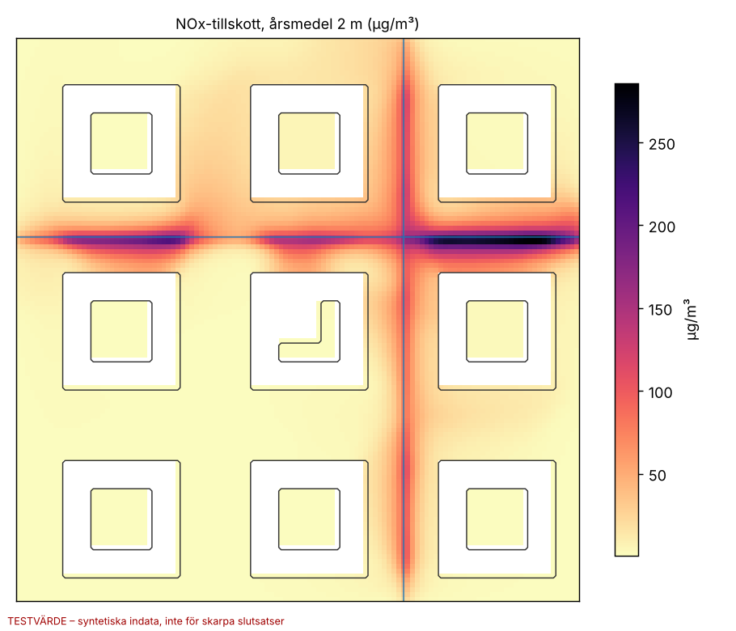
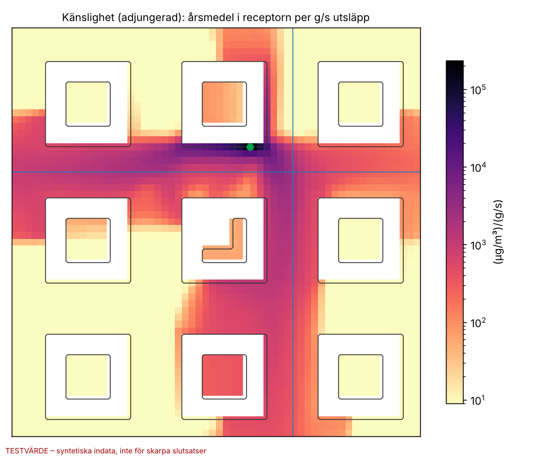
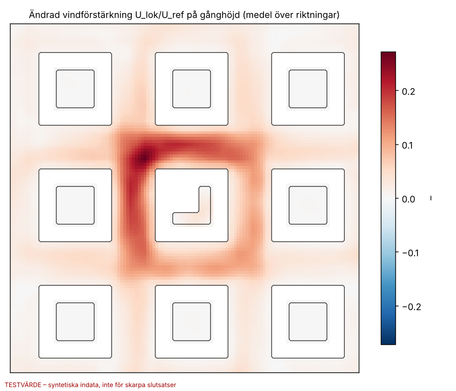

# Luft – 3D-vind, spridning och partiklar

*Spår L. Startat 2026-11-21. Kod i `src/luft/`, tester i `tests/luft/`. Prestandasiffror i detta dokument är
mål eller uppskattningar tills de står i `STATUS.md` med mätvärden.*

**Licens:** MIT (`src/luft/LICENSE`, beslut 2026-11-21). Luft får inte importera SFINCS-härledd GPL-kod.

## 1. Idé

Luftkvalitet i gaturum avgörs av tredimensionell strömning runt byggnader. Dagens planeringsverktyg är antingen
halvempiriska gaturumsmodeller (snabba men utan geometri) eller CPU-tung CFD (geometri men timmar–dygn per fall).
Floden gör så här:

1. **Strömning en gång per vindriktning** med en GPU-vänlig LES (lattice Boltzmann). Det dyra steget.
2. **Spridning som ett linjärt problem** på det sparade medelfältet. Halten är linjär i utsläppen, så
   operatorn byggs en gång och återanvänds för alla källor, scenarier och vindhastigheter.
3. **Statistik genom viktning** med väderdata, inte genom att simulera ett år.
4. **Adjungerad lösning** för frågor i en punkt (förskolegård, fasad): ett enda linjärt system ger påverkan
   från alla möjliga källor.

## 2. Matematik

### 2.1 Strömning: LBM-LES (D3Q19)
- Lattice Boltzmann med 19 hastigheter. Varje steg är lokal kollision + strömning, vilket parallelliseras
  nästan perfekt på GPU.
- Kollision: reguljariserad BGK (projektion av icke-jämviktsdelen på andra ordningens moment). Stabilare än
  ren BGK nära τ = 0,5, vilket är det relevanta läget vid höga Reynoldstal.
- Turbulens: Smagorinsky, `ν_t = (C_s Δ)² |S|`, där `|S|` beräknas lokalt ur icke-jämviktsmomentet
  (ingen finita differenser behövs). Effektiv relaxationstid `τ = 3(ν₀ + ν_t) + 1/2` i gitterenheter.
- Randvillkor: inflöde = jämvikt med logaritmisk profil (`Inflode`); utflöde = noll gradient;
  sidor = periodiska; tak = friktionsfritt (spegling); mark och byggnader = halvvägs studs (bounce-back).
- Vegetation: dragkraft `F = −C_d · LAD · |u| u` via Guos kraftterm.
- Enheter: `dt = dx · u_lat / u_ref`, med `u_lat ≤ 0,1` (Mach-gräns).

**Senare steg (inte v1):** väggmodell (log-lag) på byggnadsytor, termisk skiktning (Boussinesq,
Monin–Obukhov vid marken, jfr VirtualFluids/Uppsala), nästlade rutnät, kumulantkollision.

### 2.2 Spridning: linjär operator på medelfältet
Stationär advektion–diffusion för halten `c` (g/m³):

```
∇·(u c) − ∇·(K ∇c) + λ c = s,      K = ν_t / Sc_t + D,  Sc_t ≈ 0,7
```

Diskretiseras med finita volymer på samma rutnät:
- Flöden på cellytor. Ytflödena **projiceras divergensfria** (Helmholtz-projektion: lös en Poissonekvation
  för korrektionen) innan operatorn byggs. Då blir uppströmsoperatorn en M-matris: halter blir aldrig negativa
  och massan bevaras exakt.
- Advektion: uppströms (standard, monoton) eller TVD (van Leer/Koren) med begränsaren *frusen* ur en
  referenslösning och begränsad till 2/Pe per yta, så att operatorn förblir linjär och en M-matris
  (superposition, adjungerad dualitet och positivitet gäller exakt). Vinsten är störst vid låga cellpecletal.
- Lösare: symmetrisk Gauss–Seidel-förkonditionering med celler numrerade medvinds (nästan exakt för
  advektionen), transponerad för den adjungerade; projektionen med geometrisk multigrid-förkonditionerad CG.
- Deposition som sänka på ytor mot fast cell (`v_d`, m/s); partiklar får sedimentationshastighet `w_s`
  som läggs på den vertikala hastigheten.
- Randvillkor: inflöde c = 0 (bakgrundshalt adderas separat); utflöde och tak = advektivt utflöde.

Det ger ett glest system `A c = s`. Viktiga egenskaper:
- **Många källor samtidigt**: `A C = S` med en kolumn per källgrupp. Förkonditioneraren (ILU) byggs en gång.
- **Adjungerad**: halten i receptorn `r` från alla källor är `rᵀ A⁻¹ s = (A⁻ᵀ r)ᵀ s`. Ett system med `Aᵀ`
  ger en *känslighetskarta*: g/m³ i receptorn per g/s utsläpp i varje cell. Dualiteten är exakt i diskret
  mening och testas.
- **Hastighetsskalning**: vid neutral skiktning skalar `u` och `K` med `U`, så `A(U) = (U/U_ref) A(U_ref)`
  (utom deposition och sedimentation) och `c ∝ 1/U`.

### 2.3 Statistik
Väderdata (timvärden: riktning, hastighet) → varje timme väljer närmaste riktningssektor i vindbiblioteket
och skalar med `U_ref / U`. Ger årsmedel, percentiler och antal timmar över ett gränsvärde utan att lagra
alla timfält (strömmande räkning). Svag vind (`U < u_min`) flaggas och räknas inte med skalning.

### 2.4 NO₂-kemi
Fotostationär jämvikt `NO + O₃ ⇄ NO₂` med bevarade summor `NOx = NO + NO₂` och `Ox = NO₂ + O₃`.
Jämvikten `J·[NO₂] = k·[NO]·[O₃]` ger en andragradsekvation med sluten lösning. Indata: lokalt NOx-tillskott
(modell), direkt NO₂-andel i utsläppet, bakgrund NO₂/O₃, `J` och `k`. Detta är samma förenkling som i
gaturumsmodeller av OSPM-typ; den antar att kemin hinner i jämvikt och överskattar därför NO₂ något nära
källan. Begränsad uppehållstid läggs till senare.

### 2.5 Partiklar och vägdamm
PM behandlas i v1 som spårämne med `w_s` och `v_d`. Emission från vägslitage och uppvirvling (dubbdäck,
sandning, fukt) kräver en egen emissionsmodell av NORTRIP-typ; den byggs som eget uppdrag och ger
`s` till operatorn. Inga emissionsfaktorer hårdkodas: de är indata, och testvärden markeras som sådana.

### 2.6 Vindkomfort och höga hus
Samma vindbibliotek ger *förstärkningen* `A_d = |u_h| / u_ref` på gånghöjd per riktning. Vid neutral skiktning
är den oberoende av vindstyrkan, så andelen timmar med lokal vind över en tröskel V blir
`P = Σ_d #{h ∈ d : U_h > V / A_d} / N`, exakt med sortering och binärsökning. Byighet (Lawson, GEM) använder
standardavvikelsen `u_std` från LES: `Ã = max(A, (A + g·σ/u_ref)/1,85)`. Kriterier med källa i
`vindkomfort.KRITERIER`:
- **NEN 8100:2006**: 1,75 m, tröskel 5 m/s; klass A–E vid <2,5 / 2,5–5 / 5–10 / 10–20 / ≥20 % av timmarna;
  fara 15 m/s: 0,05–0,3 % begränsad risk, ≥0,3 % farligt.
- **Lawson LDDC** (variant enligt CPP Wind): max(medel, GEM) ≤ 4/6/8/10 m/s högst 5 % av tiden
  (sitta/stå/promenera/gå målmedvetet); fara över 15 resp. 20 m/s mer än 0,022 %.

Ingen svensk norm finns; valet är ett planeringsbeslut. Väderdata räknas om till inflödets referenshöjd och
råhet med `omrakna_vindhastighet` (log-lag via blandningshöjd, som är indata). Före/efter: två vindbibliotek
(nuläge, förslag) → `jamfor` ger ändrad klass och ändrad överskridandeandel. Gånghöjd kräver fint rutnät nära
marken (helst ≤ 1–2 m celler); grövre rutnät ger en varning och är bara översiktligt.

### 2.7 Randvillkor och noggrannhet (L-d)
Standard sedan L-d: inflöde med icke-jämviktsextrapolation (Guo m.fl. 2002), tryckutflöde (ρ = 1), start
från profilen och `u_lattice="auto"` (Mach-mål 0,15). L-a-randen gav ca 30 % för lågt massflöde och finns
kvar som val (`inflodesrand="jamvikt"`). Valbart: väggmodell (log-lag som väggkraft, `vaggmodell="loglag"`)
och syntetiska virvlar vid inflödet (SEM, `inflodesturbulens="virvlar"`). Kraftfelet i den reguljariserade
kollisionen (halverad kraft nära τ = ½) är rättat.

## 3. Moduler

| Modul | Innehåll |
| --- | --- |
| `luft/typer.py` | `Voxelgrid`, `Inflode`, `Vindfalt`, `LuftFel` (kontrakt KL1) |
| `luft/backend.py` | `hamta_backend("numpy" \| "cupy")` |
| `luft/lbm.py` | D3Q19 LBM-LES → `Vindfalt` |
| `luft/geometri.py` | höjdraster → `Voxelgrid`, rotation per vindriktning, källor från linjer |
| `luft/transport.py` | `TransportOperator`: glesa operatorn, `los`, `los_adjungerad`, projektion |
| `luft/kemi.py` | fotostationär NO₂ |
| `luft/vindbibliotek.py` | bibliotek över riktningar, viktning med väderdata, statistik |
| `luft/export.py` | KL2-utdata (GeoTIFF/npz + `run.json`) |
| `luft/emission.py` | vägdamm och avgaser per vägavsnitt och timme (NORTRIP-typ), `timvis_halt` |
| `luft/vindkomfort.py` | vindkomfort och vindfara på gånghöjd (NEN 8100, Lawson LDDC), före/efter |
| `luft/kedja.py` | hela kedjan: `bygg_vindbibliotek`, `berakna_halter`, `kanslighet_for_receptor` |
| `luft/cli.py` | `floden luft vind \| halt \| demo` |

### 3.1 Gränssnitt (v1)

```python
# luft/lbm.py
@dataclass(frozen=True)
class LbmParametrar:
    u_lattice: float = 0.08          # gitterhastighet för u_ref
    smagorinsky_cs: float = 0.16
    nu_molekylar_m2_s: float = 1.5e-5
    cd_vegetation: float = 0.2
    upprampning_genomstromningar: float = 2.0   # tid före medelvärdesbildning, i domänlängder
    medel_genomstromningar: float = 2.0
    max_steg: int = 200_000
def kor_les(grid: Voxelgrid, inflode: Inflode, param: LbmParametrar = ...,
            backend: str = "numpy", logg: Callable[[str], None] | None = None) -> Vindfalt

# luft/transport.py
@dataclass(frozen=True)
class Amne:
    namn: str
    sc_t: float = 0.7
    diffusivitet_m2_s: float = 2e-5
    deposition_m_s: float = 0.0
    sedimentation_m_s: float = 0.0
    nedbrytning_1_s: float = 0.0
class TransportOperator:
    def __init__(self, vind: Vindfalt, amne: Amne, projicera: bool = True) -> None
    def los(self, kallor_g_s: np.ndarray) -> np.ndarray          # (nx,ny,nz) eller (n,nx,ny,nz)
    def los_adjungerad(self, receptor: np.ndarray) -> np.ndarray # (nx,ny,nz) → (nx,ny,nz)
    def massbalans(self, kallor_g_s, halt_g_m3) -> dict[str, float]

# luft/kemi.py
def no2_fotostationar(nox_lokalt_ug_m3, no2_bakgrund_ug_m3, o3_bakgrund_ug_m3,
                      direkt_no2_andel, j_no2_1_s, k_ppb_1_s, temperatur_k=288.15) -> np.ndarray

# luft/geometri.py
def voxelisera(hojd_over_mark_m, dx_m, hojd_doman_m, *, raster_dx_m, raster_origo_x_m, raster_origo_y_m,
               buffert_uppstroms_m, buffert_nedstroms_m, buffert_sidor_m, vegetation_hojd_m=None, lad_m2_m3=1.0,
               vindriktning_grad=270.0, origo_z_m=0.0) -> Voxelgrid
def linjekalla(grid, linjer_xy_m, emission_g_m_s, hojd_m=0.5) -> np.ndarray  # (nx,ny,nz) g/s
```

## 4. Kontrakt

### KL1 – Vindfält (v1)
Lagras som `vind_<riktning>.npz` med fälten i `Vindfalt` (`u_m_s`, `nu_t_m2_s`, `fast`, `lad_m2_m3`) och en
JSON-sträng `meta` med `dx_m`, `vindriktning_grad`, `origo_*`, `rotation_centrum_*`, `inflode`, `medelperiod_s`,
`lbm_parametrar`, `kontrakt = "KL1/v1"`. Ett vindbibliotek är en mapp med en fil per riktning och
`bibliotek.json` (riktningar, gemensamt `u_ref_m_s`, geometrins sha256).

### KL2 – Luftresultat (v1)
| Fil | Innehåll |
| --- | --- |
| `halt_<amne>_<statistik>.tif` | Halt på angiven höjd över mark (µg/m³), EPSG:3011 |
| `halt_<amne>_3d.npz` | Hela 3D-fältet (g/m³) i det roterade rutnätet, för fasadutvärdering |
| `kanslighet_<receptor>.tif` | Adjungerad karta, (µg/m³) per (g/s) |
| `run.json` | K0-manifest, `modul = "luft"`, parametrar inkl. backend och kontraktsversion |

## 5. Server
- Allt körs med `--backend numpy` lokalt (tester, små fall) och `--backend cupy` på GPU-servern.
- Minne för LBM: 19 fördelningar × 2 (dubbelbuffring) × 4 byte ≈ 150 byte/cell plus fält. Ett område på
  1 km × 1 km × 150 m med 2 m celler (≈ 1,9·10⁷ celler) kräver ≈ 3 GB; med 1 m celler ≈ 23 GB. Hela Stockholm
  i 3D körs därför område för område med överlapp, inte som ett rutnät.
- Vindbiblioteket (12–36 riktningar) är pinsamt parallellt: en GPU per riktning.
- Transportoperatorn löses på CPU (SciPy) i v1; GPU-version (CuPy sparse/AMGX) när den behövs.

## 6. Validering (testgrupp L)
| Fall | Facit | Gräns |
| --- | --- | --- |
| L1 Poiseuilleflöde i kanal | analytisk parabel | rel. L2-fel < 2 % |
| L2 Massbevarande LBM | total massa konstant | rel. drift < 1e-6 |
| L3 Kub i gränsskikt | återcirkulation bakom kuben; skarp jämförelse mot CEDVAL A1-1 görs på server | u < 0 bakom kub |
| L4 Punktkälla i likformigt flöde | analytisk lösning med spegelkälla i mark | rel. fel < 10 % utanför 3 celler från källan |
| L5 Adjungerad dualitet | `rᵀA⁻¹s = (A⁻ᵀr)ᵀs` | rel. fel < 1e-8 |
| L6 Massbalans spridning | utsläpp = utflöde + deposition | rel. fel < 1e-8 |
| L7 Fotostationär NO₂ | jämviktsvillkoret och summor | rel. fel < 1e-10 |
| L8 Hastighetsskalning | `c(2U) = c(U)/2` utan deposition | rel. fel < 1e-8 |

Skarp validering mot mätdata (t.ex. Hornsgatan) och vindtunnel (CEDVAL, Michelstadt) är eget uppdrag och kräver
server och data.

## 7. Körning

```bash
floden luft demo --ut demo/                       # syntetiskt kvarter, hela kedjan på CPU (~8 min)
floden luft vind --byggnader hojd.tif --ut bib/ --riktningar 12 --dx 2 --backend cupy   # server
floden luft komfort --byggnader hojd_forslag.tif --bibliotek bib_forslag/ --fore bib_nulage/ \
                    --vader vader.csv --omrakna 10 0.03 60 --kriterium nen8100 --ut komfort/
floden luft komfortdemo --ut kdemo/                # höghus före/efter i syntetiskt kvarter
floden luft halt --bibliotek bib/ --byggnader hojd.tif --vagar vagar.gpkg --vader vader.csv \
                 --grans 40 --percentil 98 --receptor 152140 6577170 --ut resultat/
```

Rastret ska vara EPSG:3011, nordorienterat. Vägarna behöver fältet `emission_g_m_s`. Väder-CSV:
`tid,vindriktning_grad,vindhastighet_m_s`. Figurerna i demon kräver `pip install -e ".[viz]"`, GPU-backend
`pip install -e ".[gpu]"`.




*Demo med syntetisk geometri, väder och emissioner (testvärden).*



*Komfortdemo: ett 60 m höghus i ett kvarter med 18 m hus, 4 riktningar, 5 m celler (för grovt för skarpa
slutsatser på gånghöjd – visar bara att kedjan fungerar). Testvärden.*

## 8. Färdplan

| Steg | Innehåll | Status |
| --- | --- | --- |
| L-a | Typer, LBM-LES, spridning med projektion och adjungerad, NO₂-kemi, geometri, vindbibliotek, statistik, export, CLI, demo | klar (2026-11-21) |
| L-b | Server: köra `--backend cupy`, mäta MLUPS, minnesoptimering (en buffert, streaming i ett steg, gles lagring av luftceller) | redo |
| L-c | Validering mot vindtunnel (CEDVAL A1-1, Michelstadt) med vedertagna mått (FAC2, hit rate) | redo, kräver data |
| L-d | Väggmodell (log-lag), syntetiska virvlar vid inflödet, Mach-säkert u_lattice, 2,5× snabbare, rättade randvillkor | klar (2026-11-21) |
| L-e | Termisk skiktning (Boussinesq, Monin–Obukhov) och svagvindsklasser | väntar på L-c |
| L-f | TVD-advektion (frusen, M-matrisbegränsad), 7–10× snabbare lösare; GPU-lösare kvar | TVD och CPU-lösare klara (2026-11-21) |
| L-g | Emissionsmodell för vägdamm (NORTRIP-typ: slitage, dubbdäck, fukt, sandning, salt) och avgaser | modell klar (2026-11-21), kalibrering kräver trafik- och mätdata |
| L-k | Vindkomfort och vindfara (NEN 8100, Lawson), före/efter för höga hus | klar (2026-11-21) |
| L-h | Validering mot mätstationer (t.ex. Hornsgatan) med bakgrundshalter | kräver data |
| L-i | Koppling till gemensam geometrikärna och till frågelager/webb | geometri och K20-lösare klara (2026-11-21, avsnitt 10); webb väntar |
| L-j | Lagrangepartiklar för PM-episoder och korttidsutsläpp | senare |

## 9. Öppna frågor
- Vilka väderdata (SMHI timdata, Bromma/Observatoriekullen) och bakgrundshalter (SLB-analys) ska användas?
- Emissionsdata för trafik: ÅDT, tunga andelen, dubbdäcksandel per gata.

## 10. Gemensam geometri (K1 v2, K9, markklasser)

Luften bygger sitt voxelrutnät ur samma K1 v2-rutor som dagsljus och buller (`byggnader.gpkg`, `terrang.tif`,
`vegetation.tif`, `markslag.tif`), efter att kärnan tillämpat ett K9-scenario (`byggnad_ny`, `byggnad_hojd`,
`byggnad_bort`, `vegetation`). Det gamla gränssnittet (handbyggt höjdraster → `Domanspec`/`voxelisera`) är
oförändrat och används av alla syntetiska fall.

### 10.1 Licensgräns

`src/luft/` är MIT; kärnan (`src/karna/`) är GPL v3. Därför går beroendet bara åt ett håll:

- `src/luft/` importerar **inget** ur `karna`, `markmodell`, `testsvit` eller `vatten`/`tvad`/`dynamik`
  (SFINCS-härledd kod ligger i `tvad`). Det enda utanför luft som importeras är de neutrala
  hjälpmodulerna `gemensamt.hash` och `gemensamt.manifest` (sha256 och K0-manifest; redan före
  den här ändringen), som inte är SFINCS-härledda. Ändringen i luft är två additiva delar:
  `voxelisera(lad_m2_m3=...)` accepterar även ett raster, och `Domanspec` har fältet `lad_m2_m3`.
- Allt som läser K1 ligger i kärnan: `karna.geometri.mosaik` (rutor → grövre rutnät),
  `karna.geometri.luftgeometri` (`Ytmosaik` → `Domanspec`) och `karna.luft_losare` (K21-lösarna).
  Kärnan (GPL) importerar luft (MIT), vilket licenserna tillåter; luftpaketet saknar medvetet
  `floden_losare.py`, eftersom det skulle få en fil i `src/luft/` att importera `karna.analyslosare` (GPL).
  Lösarna registreras i stället via `karna.inbyggda`. Test: `grep -rn "karna\|markmodell\|testsvit" src/luft`
  ska bara ge träffar i kommentarer och i den här texten.

### 10.2 Vad som förs över

| K1 v2 | Luftens indata | Anmärkning |
| --- | --- | --- |
| `las_ytmodell(vegetation=False)` − `las_terrang` | `Domanspec.hojd_over_mark_m` | byggnadshöjd över terräng per cell; 0 utanför byggnader; platt tak (K1 v2) |
| `vegetation.tif` (1 m) | `Domanspec.vegetation_hojd_m` | av som standard (`vegetation = false`); saknad fil ger fel, aldrig tyst nolla |
| `markslag.tif` + `data/markklasser.toml` `[luft]` | `Domanspec.lad_m2_m3` (raster) | bladytetäthet per markslag där vegetationen står |
| `markslag.tif` + `[luft]` `z0_m` | `markens_z0_m(...)` | logaritmiskt medel över markceller utanför byggnader; förslag till `z0_vagg_m` (`vaggmodell = "loglag"`) |

Omsampling till luftens rastercell (`raster_cell_m`, standard `dx_m`, en heltalsmultipel av K1:s 0,25 m):
byggnadshöjd och vegetation med `medel` (bevarar volymen, standard) eller `max` (konservativt för vindhinder),
terräng med medel, markslag med vanligaste koden. Rutnätets ursprung ligger på en multipel av cellstorleken,
så före- och efterscenarier får identiska rutnät.

**Begränsningar (redovisas i lösarens varningar och mätvärden):** luftens voxelrutnät har plan mark
(`voxelisera`), så terrängens form förs inte över och en byggnad på sluttande mark får sin höjd över lokal mark
(varning när terrängen varierar mer än en halv cell). K1 v1-rutor vägras. Celler utanför de rutor som ingår räknas
som tom mark och redovisas. Okänt markslag (kod 0) får ingen vegetation och flaggas. Inflödets z0 är en
parameter (`z0_m`, uppströms råhet), inte en markslagsegenskap: markens z0 beskriver ytan i sig och staden ligger
redan i geometrin.

### 10.3 Lösare för K20

`luft.vindkomfort` (vindkomfort och vindfara på gånghöjd, NEN 8100 eller Lawson) och `luft.halt` (årsmedelhalt
från vägar). Båda: indata `vader` (CSV `tid,vindriktning_grad,vindhastighet_m_s`), `halt` dessutom `vagar`
(GeoPackage med `emission_g_m_s`, EPSG:3011); parametrar `dx_m` (4), `riktningar` (4), `genomstromningar` (2),
`hojd_doman_m`, buffertar, `omsampling`, `vegetation`, `u_ref_m_s`, `z_ref_m`, `z0_m`, `vaggmodell`, `z0_vagg_m`
(okända parametrar ger fel). Utdata är GeoTIFF i EPSG:3011 på rutnätets cellstorlek (`komfortklass`, `faraklass`,
`forstarkning`; `arsmedel`), så `[[jamforelser]]` fungerar för före/efter. Exempel:
`exempel/fragor/luft_fore_efter.toml` (testväder, `luft_vader_testvarde.csv`).

**Påverkansradie: `None` (globalt jobb över alla rutor i scenariot).** Inget konservativt mått finns: tryckprojektionen
i LES är global, kölvattnet når ett tiotal byggnadshöjder nedströms i alla riktningar som ingår i statistiken, och
halten i en cell beror på alla källor uppströms. En radie vore ett antagande som inte kan visas, och kärnan säger
"är du osäker, välj `None`". Följden är att en K9-ändring ger ett nytt jobb för hela scenariot (ingen lokal
omräkning), och att luft bara körs på områden som ryms i minnet (mosaik av rutorna, buffertar utöver det).

### 10.4 Mätt

Syntetiskt K1 v2-kvarter byggt med markmodellens byggare (`dagsljus.exempelkvarter`, platt mark):
höjdrastret och vegetationsrastret är lika (`array_equal`) med ett handbyggt raster, och `voxelisera` ger identiskt
`fast` och `lad_m2_m3` för tre vindriktningar. `luft.vindkomfort` på K1 v2 ger exakt samma `forstarkning.tif` som
`bygg_vindbibliotek` + `berakna_komfort` på det handbyggda rastret. `byggnad_hojd` (b: 20 → 28 m) ändrar bara
b:s fotavtryck och bara lagren mellan gamla och nya takhöjden (inga voxlar blir luft); `byggnad_ny` lägger till
exakt 25 celler; `byggnad_bort` ger bas utan huset (`array_equal`). Tester: `tests/karna/test_anslutning_luft.py`,
`tests/karna/test_luft_losare.py`.

