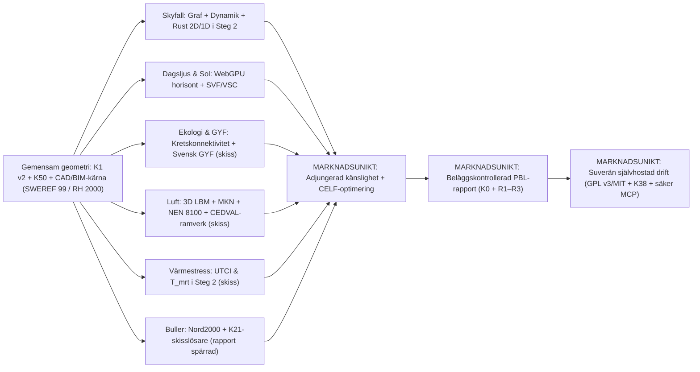

# Marknadsbenchmark 2025–2026: Floden mot ledande plan- och miljöverktyg

Uppdaterad **2026-11-26** mot **`main` @ `64d1375`** (efter PR `#143–#172`: P0-buggar B1–B14, fem utvecklingsvågor i Pass 3 + Pass 4-slutgranskning och korsvågs-E2E, samt Våg 6 `#165–#168` och Våg 7 `#169–#172`).

> [!IMPORTANT]
> **Epistemologisk regel ([`AGENTS.md`](../AGENTS.md) & [`docs/OM-FLODEN.md`](OM-FLODEN.md)):**
> Det här dokumentet skiljer strikt mellan tre kategorier av uppgifter:
> 1. **Uppmätt i Floden** — deterministiska test- och benchmarkresultat ur Flodens eget repo (alltid *Floden mot Floden* eller mot analytiska/syntetiska facitfall, med filhänvisning).
> 2. **Leverantörers och projekts publicerade uppgifter (2025–2026)** — hämtade ur respektive utgivares öppna produkt- eller projektdokumentation med källa och hämtdatum. Floden har **inte** kört eller verifierat dessa verktyg.
> 3. **Omätt** — ingen sid-vid-sid-mätning på samma indata och hårdvara har ännu körts mellan Floden och något externt verktyg, och ingen jämförelse mot lokala experimentella vindtunneldata har ännu slutförts (`jamford_mot_vindtunnel_data = False`). Inga hastighetsfaktorer ("X gånger snabbare än ...") eller fältvalideringar påstås utan verkliga referenskörningar (`T09b`, `J1`, `L-c`).
>
> **Metodstatus och frysta filer:** Samtliga **16 av 16 metoder** i metodregistret ([`data/matematik/metoder.toml`](../data/matematik/metoder.toml) / [`data/mcp/metodstatus.toml`](../data/mcp/metodstatus.toml)) samt nytillkomna moduler (UTCI/$T_{\text{mrt}}$, Svensk GYF, K21 `buller.nord2000` och CEDVAL A1-1-ramverket) har fortsatt status **`skiss`** (`0` metoder klassade som `rapport`), och **`nord2000_konform = False`** (formella bullerrapporter fortsatt spärrade). Den publika sidan `#/om` ([`data/om/floden.toml`](../data/om/floden.toml) och [`docs/OM-FLODEN.md`](OM-FLODEN.md), genererade 2026-11-25) lämnas avsiktligt orörd här och uppdateras bara genom separat granskat beslut.

---

## 1. Uppmätt utgångsläge i Floden (`main` @ `64d1375`)

Alla mätvärden nedan kommer från Flodens egna test- och benchmarkkörningar (ingen jämförelse med andra produkter):

- **Kod-, bygg- och teststatus (`64d1375`, PR `#143–#172`):** GitHub `CI` **11/11 grön** på samtliga 30 PR:er `#143–#172`, `Avbildning` grön, `ruff check src tests testsvit` **0 fel**, `mypy --platform linux src` **0 fel** (**392** källfiler), `tests/gemensamt/test_paketgranser.py` **5/5** (MIT- och domängränser intakta), 4-vägs merge-verifiering i Våg 6 **693/693** `pytest` och i Våg 7 **2 189/2 189** `pytest` (42 skipped), webbklient **481/481** TypeScript-tester + `tsc --noEmit` **0 fel** + `vite build` **OK** (källa: [`STATUS.md`](../STATUS.md)).
- **Facit- och verifieringssviter:**
  - **Skyfall:** `floden testsvit` **18/18 godkända** (`0,0000 %` volymfel; grupp A `A0–A13` + `A5b`, Environment Agency `EA1`/`EA2`/`EA8A` samt Hunters analytiska fall `D1`; källa: [`docs/VALIDERING.md`](VALIDERING.md), [`STATUS.md`](../STATUS.md)). Bitidentisk Rust 2D + 1D-rännsten (`vatten.2d`) och härledd `fara = max_djup * hastighet` (`atol = 1e-5`, exakt `NaN`-bevarande) är nu exponerade som valbart läge i Steg 2 (`#168`).
  - **Dagsljus, sol och termiskt mikroklimat:** grupp E (`E1–E7`) **7/7 godkända**; solposition mot NREL SPA (2000–2040) max **0,013°** höjdavvikelse (källa: [`STATUS.md`](../STATUS.md), [`docs/OM-FLODEN.md`](OM-FLODEN.md)). Ny fristående domän `src/mikroklimat/` (`#167`, [`docs/MIKROKLIMAT.md`](MIKROKLIMAT.md)) och webb-API/Steg 2 (`#172`): samtliga 210 UTCI-koefficienter (Bröde 2012) + Hardy ITS-90 korskontrollerade över 481 giltiga 4D-punkter mot `UTCI_a002.f90` med max avvikelse **`6,82e-13 °C`**, 6-riktnings $T_{\text{mrt}}$ isotermiskt svartkroppsfacit **`0,00e+00 °C`** (`skiss`; SOLWEIG/UMEP-jämförelse & fältvalidering återstår).
  - **Ekologi och Svensk GYF:** analytiska facitfall `G1–G6` och K21-lösartest `G7` godkända; parametrar källbelagda för nätverk (`data/ekologi/natverk/`), biologisk säkerhet låg och ej fältvaliderad (källa: [`docs/EKOLOGI.md`](EKOLOGI.md), [`data/mcp/metodstatus.toml`](../data/mcp/metodstatus.toml)). Ny `src/ekologi/gyf.py` + `data/gyf/profiler.toml` (`#165`, [`docs/GYF.md`](GYF.md)) och webb-API/Steg 2 (`#172`): tre kommunprofiler (`stockholm`, `goteborg`, `malmo`, riktmärke `0,60`) verifierade till **`0,00e+00`** mot oberoende handräkning, med explicit flaggning av okända K1-koder/`NaN` (`skiss`, vikter ej granskade av Joel).
  - **Luft:** analytiska fall `L1–L8` (bl.a. Poiseuille-flöde och adjungerad dualitet `< 1e-12`) godkända (källa: [`docs/LUFT.md`](LUFT.md), [`docs/MATEMATIK.md`](MATEMATIK.md)). Nytt CEDVAL A1-1 vindtunnelvalideringsramverk (`src/luft/cedval.py`, `tools/validera_cedval.py`, [`docs/luft/cedval.md`](luft/cedval.md), `#169`, MIT-gräns intakt) med CPU-baslinje (`snabbvind` `0,331 s` vid `dx = 5 m` / `2,775 s` vid `dx = 2,5 m`, `lbm` `11,736 s` kompakt `dx = 5 m`, no-slip `0,0000 m/s`, `X_R/H = 4,170` på grovt rutnät `H/dx = 5`) och COST 732-mått; **`jamford_mot_vindtunnel_data = False`** tills lokala EWTL-mätdata & GPU-körning genomförs.
  - **Buller (Nord2000):** officiell testsvit RL 18-18 (grupp N, lokalt facit ej i git): **57/80 godkända** (43/62 rak väg efter PR `#122`, 10/10 kurvig väg, 4/4 stadsgata), **15 ska utredas**, **4 underkända** (`N18R052`, `062`, `102`, `103`), **4 ej körbara** (årsmedel `N18A1–A4`). Ny K21-skisslösare `buller.nord2000` (`src/buller/losare_k21.py`, [`docs/buller/k21.md`](buller/k21.md), `#171`) med verifierad avståndsdämpning och K9-skärm-/byggnadsdämpning (`-14,72` resp. `-29,46 dB(A)` på testkvarter), `NaN`-maskade byggnader och bitidentisk reproducerbarhet. **`nord2000_konform = False`**, rapportläge fortsatt spärrat, webbflik byggs i Våg 8 (källa: [`PLAN.md`](../PLAN.md), [`STATUS.md`](../STATUS.md)).
  - **CAD/BIM-interoperabilitet (`#170`):** ny `src/lapp/cad_bim.py` ([`docs/CAD-BIM.md`](CAD-BIM.md), 0 nya tredjepartsberoenden) med rundturstestad GPKG-reprojektion `EPSG:3006 → 3011` (`max_xy = 2,81e-9 m`), DXF ASCII (`max_z = 0,0 m`), LandXML 1.2 TIN (`max_z = 4,58e-7 m`, `NaN`-hopp), IFC STEP-SPF (`MILLI`/`CENTI` + 3D-rotation, `< 1e-6 m`) samt `.obj` och binär `.glb` glTF 2.0 (`0x46546C67` v2, `EPSG:3011` i `asset.extras`); webb-API/UI byggs i Våg 8.
- **Interna prestandamätningar (*Floden mot Floden*):**

| Mätning (Floden mot Floden) | Uppmätt resultat | Kontekst & begränsning | Källa i repot |
| :--- | :--- | :--- | :--- |
| Dagsljus 300 × 300 m, SVF + soltimmar (64 riktningar): WebGPU (`f32`) vs server-CPU (`f64`) | **≈ 79×** (`53,9 ms` vs `4 242,6 ms`) | Apple Metal 3 (Chrome 157) mot `floden.berring.se` CPU; SVF-avvikelse `0,0126` (> `0,01`) i 13/90 000 celler nära fasader | [`docs/benchmark/2026-11-23-mac-webgpu.json`](benchmark/2026-11-23-mac-webgpu.json) |
| Vatten 2D 64 × 64 celler, 1 000 tidssteg: WebGPU (`f32`) vs server-CPU (`f64`) | **≈ 25×** (`9,9 ms` vs `244,2 ms`) | Jämfört mot skuggarens egen `f64`-referens, inte `tvad.lokal_troghet` | [`docs/benchmark/2026-11-23-mac-webgpu.json`](benchmark/2026-11-23-mac-webgpu.json) |
| Hybrid (sänkgraf + 2D) vs full 2D (Floden) | **1,2–1,8×** | Uppmätt efter vattenkärnans rättelser 2026-11-23 (tidigare `12,9–20×` gäller ej längre) | [`docs/MATEMATIK.md`](MATEMATIK.md) |
| Lokal omräkning vs full omräkning (16 kvarter) | **9,28×** (`26,7 ms` vs `247,4 ms`) | Bitexakt (`0,00 m` avvikelse); mätt 2026-11-20 (T04) före vattenkärnans rättelser, ej omkörd | [`STATUS.md`](../STATUS.md) |
| ZSTD-COG lagringskomprimering (0,5 m-ruta) | **13,1 %** av råstorlek (`3,79 MB` vs `28,85 MB`) | Uppmätt vid införande av S3/COG-lagring (PR `#120`) | [`PLAN.md`](../PLAN.md) |
| CEDVAL A1-1 CPU-baslinje (`snabbvind` vs `lbm`) | `snabbvind`: `0,331 s` (`dx=5 m`) / `2,775 s` (`dx=2,5 m`); `lbm`: `11,736 s` (`dx=5 m` kompakt) | Grov CPU-baslinje (`jamford_mot_vindtunnel_data = False`); fin LBM-validering (`H/dx >= 20`) kräver GPU | [`docs/luft/cedval.md`](luft/cedval.md) |
| Baslinjekörtider på delad molncontainer (2 vCPU, 8 GB, ingen GPU) | EA1 `0,55 s`, D1 `0,83 s`, EA8A `1,75 s`, EA2 `3,43 s`, SVF+sol 300 m `5,03 s`, `demo --liten` `11,4 s`, luft L4 `0,111 s` | Delad container med hög spridning; hel vindkomfortkörning för luft tar **> 10 min** på CPU (`data/mcp/metodstatus.toml`) | [`docs/benchmark/2026-11-23-container.json`](benchmark/2026-11-23-container.json) |

---

## 2. Konkurrentmatris (2025–2026, offentliga uppgifter)

*Samtliga uppgifter om externa produkter bygger på offentlig produkt- eller projektdokumentation 2025–2026 (se källregistret i tabell 2.3). Att en funktion inte nämns innebär inte att utgivaren saknar den i varje modul, endast att den inte framgick av läst dokumentation. **Inga sid-vid-sid-körningar har utförts.***

### 2.1 Breda plan-, vatten-, klimat-, luft- och bullerverktyg

| Förmåga / Område | **Floden (`64d1375`)** | **SCALGO Live** | **Autodesk Forma** | **ArcGIS Urban** | **MIKE+ / InfoWorks ICM** | **SMHI SIMAIR / Airviro** | **SoundPLAN / CadnaA / NoiseModelling** | **ENVI-met / UMEP (SOLWEIG) / GYF** |
| :--- | :--- | :--- | :--- | :--- | :--- | :--- | :--- | :--- |
| **Primär målgrupp** | Svenska kommuner, stadsplanerare & utredare (PBL) | Skyfalls-/terränganalytiker, kommuner & konsulter | Arkitekter & stadsutvecklare i tidiga skeden | Kommunala stadsplanerare (zoning/3D-scenarier) | VA-specialister & hydrologer | Svenska kommuner, luftvårdsförbund & miljökonsulter (MKN) | Akustiker & bullerutredare | Mikroklimat-/landskapsutredare & kommuner |
| **Skyfall & 2D-hydraulik** | Statisk sänkgraf + händelsestyrd dynamik + bitidentisk **Rust 2D + 1D-rännsten (`vatten.2d`) valbar i Steg 2** med hastighet & fara `h·v` *(`#168`, `skiss`)* | **Marknadsledare i skiss/PBL:** rikstäckande terräng, Flash Flood Map, Modelspaces & Core+ DynamicFlood (TUFLOW, GPU-kö) | Saknas (ingen yt-/skyfallshydraulik) | Saknas (endast kart-/planredovisning, ej hydraulik) | **Branschstandard:** full 1D/2D-hydraulik, MIKE FM / ICM subgrid, CUDA-GPU | Saknas | Saknas | ENVI-met/UMEP har förenklad ytvatten-/energibalans, ej skyfall |
| **1D-ledningsnät (VA)** | Uttrycklig `avtappning_mm_h` + 1D-rännstenskedjor *(M7 SWMM ej byggd)* | Förenklad avrinnings-/kapacitetsavdragning, ej full tryckledning | Saknas | Saknas | **Full 1D–2D kopplad hydraulik** (ledningsnät, brunnar, pumpar, överdämning) | Saknas | Saknas | Saknas |
| **Dagsljus & sol** | Horisont (WebGPU ~79× Floden-mot-Floden, K21-cache), SVF, VSC, soltimmar mark/fasad, brukstid, ögonblicksskugga *(ej inomhus-DF)* | Saknas | Soltimmar, dagsljuspotential & solenergi (PV) i molnet | Shadow Cast / Sunlight Analysis (kumulativ sol/skugga & tröskelvärden i 3D-scenarier) | Saknas | Saknas | Saknas | UMEP/SOLWEIG beräknar SVF, skuggor & kort-/långvågig strålning *(för inomhus-DF/sDA se tabell 2.2)* |
| **Värmestress / Mikroklimat (UTCI / $T_{\text{mrt}}$)** | **Ja (`skiss`, `#167`/`#172`):** officiell UTCI (Bröde 2012, 210 koeff., max `6,82e-13 °C` mot `UTCI_a002.f90`) + 6-riktnings $T_{\text{mrt}}$ ovanpå K1 v2 SVF/skugga i kärna, API & Steg 2 *(SOLWEIG/UMEP-jämförelse & fältvalidering kvar)* | Saknas | **Ja:** utomhus mikroklimat (upplevd temperatur / UTCI-baserad komfort) | Saknas | Saknas | Saknas | Saknas | **Marknads-/forskningsstandard:** ENVI-met (3D CFD) & UMEP/SOLWEIG (utvecklat vid Göteborgs universitet) räknar $T_{\text{mrt}}$, UTCI/PET & trädkylning |
| **Ekologi & Grönytefaktor (GYF)** | Kretskonnektivitet (`PC`/`ECA`/`dPC`), adjungerad `kansighet`, CELF, NMD/VMI/träd **+ Svensk GYF** (`stockholm`/`goteborg`/`malmo` TOML-profiler, före/efter & delfaktortabell i kärna, API & Steg 2, `#165`/`#172`; *R2-rapportpåståenden & viktgranskning kvar, `skiss`*) | Saknas | Saknas (endast enklare ytmått) | Kapacitets-/planindikatorer, ingen kretsteoretisk konnektivitet | Saknas | Saknas | Saknas | **Svenska GYF-verktyg** drivs främst som kommunala Excel-/GIS-modeller (Stockholm, Göteborg, Malmö; Boverkets vägledning) |
| **Luftkvalitet & vindkomfort** | 3D LBM-LES + snabbvind, M-matris, PM10/NORTRIP, NEN 8100 vindkomfort, MKN-intervall + **CEDVAL A1-1-ramverk/COST 732 (`#169`)** *(CPU långsam, lokal vindtunnel-CSV & GPU kvar, `skiss`)* | Saknas | **Snabb AI-vind** + moln-CFD för vindkomfort *(ingen kemisk MKN/PM10)* | Saknas | Saknas | **Svensk myndighetsstandard** för MKN (NO₂, PM₁₀, PM₂,₅; MATCH + OSPM + HBEFA/NVDB + NORTRIP + FAIRMODE) | Saknas | ENVI-met modellerar 3D-vind och lokal spridning på kvartersnivå (CPU-tung) |
| **Buller** | Nord2000 referenskärna **57/80** i RL 18-18 + CELF-skärmar + **K21-skisslösare `buller.nord2000` (`#171`)** *(`nord2000_konform = False`, rapport spärrad, webbflik byggs i Våg 8)* | Saknas | Översiktlig trafikbulleranalys i dB *(ej Nord2000-certifierad)* | Saknas | Saknas | Saknas | **Branschstandard:** Nord2000 (SoundPLAN; CadnaA via SINTEF-DLL för industri) & CNOSSOS-EU (inkl. öppna NoiseModelling) | Saknas |
| **Interaktiv 3D-redigering & CAD/BIM** | 3D-ritlager K50, slänter, riv hus, skarvpanel, tvärsektion, CAD-mått, GeoJSON + **CAD/BIM-kärna (`#170`):** GPKG, DXF ASCII, LandXML 1.2 TIN, IFC STEP-SPF & 3D-mesh `.obj`/`.glb` *(webb-API/UI byggs i Våg 8)* | Interaktiva arbetsytor, LandXML-import (TIN), raster-/vektor-/DXF/DWG-export & TUFLOW-paket | **Marknadsledare:** parametrisk 3D-massing + dubbelriktad Revit/Rhino & IFC (2x3/4/4.3) Data Exchange | 3D-zoning, byggvolymer, detaljplanescenarier i webben (ArcGIS-ekosystemet) | Import av CAD/GIS/VA-databaser, tung desktop-UX | Ingen interaktiv 3D-planredigering | Import av 3D-terräng/byggnader (DXF/GPKG/CityGML m.m.), tung desktop | QGIS-plugin (UMEP) resp. egen 3D-editor (ENVI-met) |
| **Åtgärdsoptimering (Adjungerad / CELF)** | **Unik kombination:** exakt adjungerad känslighet + submodulär CELF för rutter, ekologi, luft & bullerskärmar | Manuell "rita och testa igen" | Manuell / generativ volymutforskning *(ej adjungerad fysikoptimering)* | Manuell scenariojämförelse | Manuell / skriptad scenariojämförelse | Manuell scenariojämförelse | Vissa heuristiska skärmoptimerare | Manuell |
| **Beläggskontrollerade PBL-rapporter & AI/MCP** | **Unikt:** deterministisk beläggskontroll (SHA-256), 90 svenska PBL-frågor, Word/PDF + K38-säker MCP-server | Kart-/sektionsexport, ingen kontrollerad utredningstext | Dashboard-/PDF-översikter, ingen svensk PBL-rapportkontroll | Dashboard/scenariomått, ingen svensk PBL-beläggskontroll | Tekniska resultatfiler/rapporter | Myndighetsanpassade MKN-tabeller | Tekniska bullerprotokoll | Raster/tabeller |
| **Suverän drift, öppenhet & sekretess (K38)** | **GPL v3 / MIT, självhostbar i EU/lokalt**, K38-skydd för stängda baskartor & ledningar, hashkedjad logg | Stängd kommersiell SaaS-molntjänst | Stängd USA-baserad SaaS-molntjänst | Stängd kommersiell SaaS (Esri) | Stängd, dyr desktop-/molnlicens | Nationell tjänst (SMHI) / kommunlicens | Stängd licens (SoundPLAN/CadnaA); **NoiseModelling är GPL v3** | **UMEP/SOLWEIG är öppen (QGIS)**; ENVI-met är kommersiell |
| **Myndighetsacceptans & referensvalidering** | **Svagast idag:** 0 externa sid-vid-sid-körningar / riktiga vindtunnel-CSV-mätningar, samtliga metoder `skiss` (16/16 i registret + nya moduler), `nord2000_konform = False`; CEDVAL-ramverk klart (`#169`) | **Mycket hög** i svenska kommuner | **Hög** hos arkitektkontor i tidiga skeden | **Hög** i kommuner med Esri-plattform | **Högst** hos VA-bolag (SVOA, Kretslopp m.fl.) | **Myndighetsreferens** (SMHI / Naturvårdsverket) | **Myndighetsreferens** (Nord2000 / CNOSSOS-EU) | **Hög forskningsacceptans** (SOLWEIG från Göteborgs universitet) |

### 2.2 Kompletterande specialist- och referensverktyg (Dagsljus & Ekologi)

Dessa verktyg är inte breda stadsbyggnadsplattformar, men utgör bransch- och forskningsreferenser för Flodens validering (`J1` / `Uppdrag 8` / `Uppdrag 12`):

| Förmåga / Område | **Floden (`64d1375`)** | **Radiance / ClimateStudio (+ Accelerad / Honeybee)** | **Circuitscape 5 / Conefor Sensinode (+ Linkage Mapper)** |
| :--- | :--- | :--- | :--- |
| **Fysik / metod** | Horisontprofiler, SVF, VSC (BRE), soltimmar mark/fasad, ögonblicksskugga + UTCI/$T_{\text{mrt}}$ (`#167`/`#172`) *(ej inomhus-DF eller sekundär reflektion)* | **Fysikreferens för ljus:** ray tracing (Radiance); ClimateStudio kör hårdvaruaccelererad progressiv path tracing i Rhino för DF, sDA, bländning & årligt dagsljus | **Forskningsreferens för konnektivitet:** Circuitscape 5 (kretsteori i Julia) och Conefor (PC/ECA/dPC i C++); Linkage Mapper (minsta-kostnadskorridorer i ArcGIS) |
| **Arbetsflöde & 3D-UX** | Integrerad 3-stegs webb-UX med K50-ritlager & före/efter i SWEREF 99 | Rhino-plugin (ClimateStudio), CLI (Radiance/Accelerad) eller Grasshopper/Pollination (Honeybee) — kräver specialistmodellering | Desktop/CLI/GIS-skript utan integrerad 3D-planredigering eller koppling till skyfall/dagsljus/luft |
| **Licens & drift** | GPL v3 / MIT, självhostbar | Radiance: öppen källkod (LBNL); Accelerad: gratis EULA (CUDA); ClimateStudio: kommersiell licens | Circuitscape 5: **MIT**; Conefor: **GPL v2** (SourceForge senast uppdaterad 2013-05-30); Linkage Mapper: ArcGIS-verktygslåda |
| **Roll gentemot Floden** | Egen referensbas (`skiss`) | Öppen referens för Flodens dagsljusvalidering (`Uppdrag 8` / `J1`) och målbild om Fas 5 (DF) beslutas | Öppen referens för Flodens ekologivalidering (`Uppdrag 12` / `J1`) |

### 2.3 Källregister för externa produkter (2025–2026)

*Källor med hämtdatum `2026-11-25` är desamma som i [`docs/OM-FLODEN.md`](OM-FLODEN.md); källor med hämtdatum `2026-11-26` kompletterar bilden för marknadsbenchmarken.*

| Produkt / Projekt | Utgivare | Publicerad licens / drift | Publicerade uppgifter / egna prestandatal (ej verifierade av Floden) | Officiell källa | Hämtdatum |
| :--- | :--- | :--- | :--- | :--- | :--- |
| **SCALGO Live** (Flash Flood Map, Modelspaces, Core+ DynamicFlood) | SCALGO | Kommersiell SaaS (+ Core+ tillägg) | Stationär sänkfyllning (Flash Flood Map), interaktiva Modelspaces, LandXML-import (TIN), raster-/vektor-/DXF/DWG-export samt 2D-hydraulik via TUFLOW (GPU-kö, TUFLOW-paket kan laddas ner med egen licens). Ingen hastighetsfaktor angiven. | [Flash Flood Map](https://scalgo.com/en-US/scalgo-live-documentation/analysis/flash-flood-map), [Hydrodynamic Engine](https://scalgo.com/en-US/scalgo-live-documentation/hydrodynamic-engine/introduction), [SCALGO Docs](https://scalgo.com/docs) | 2026-11-25 / 2026-11-26 |
| **Autodesk Forma** | Autodesk | Kommersiell moln-SaaS (AEC Collection) | Tidigt skede i webben: sol/dagsljus/PV, snabb AI-vind + moln-CFD, utomhus mikroklimat (upplevd temperatur/UTCI), översiktligt trafikbuller, Revit/Rhino-koppling samt IFC 2x3/4/4.3 via Data Exchange. | [Autodesk Forma](https://app.autodeskforma.com) / Autodesk Forma-dokumentation | 2026-11-26 |
| **ArcGIS Urban** | Esri | Kommersiell SaaS | 3D-stadsplanering, detaljplan-/zoningscenarier, kapacitetsmått och *Shadow Cast / Sunlight Analysis* (kumulativ sol/skugga och tröskelvärden). | [ArcGIS Urban Docs](https://doc.arcgis.com/en/arcgis-urban/), [Analysis](https://doc.arcgis.com/en/arcgis-urban/latest/get-started/analysis.htm), [Shadow Cast](https://doc.arcgis.com/en/arcgis-urban/latest/get-started/work-with-shadow-cast.htm) | 2026-11-26 |
| **MIKE+ & MIKE 21 FM** | DHI | Kommersiell licensfil (SMA) | MIKE+ Collection Systems (1D: MIKE 1D/SWMM) + 2D Overland (MIKE FM) med NVIDIA CUDA-GPU; MIKE 21 FM kör hydrodynamik/transport på CUDA-GPU. Ingen egen hastighetsfaktor läst. | [DHI MIKE+ Docs](https://wiki.mikepoweredbydhi.com/), [DHI GPU-stöd KA-01054](https://support.dhigroup.com/knowledgebase/article/KA-01054/en-us) | 2026-11-25 / 2026-11-26 |
| **InfoWorks ICM** | Autodesk | Kommersiell licens | Integrerad 1D/2D-hydraulik för avloppsnät och ytvatten med subgrid och CUDA-GPU. *Tillverkarens egen uppgift (utan redovisad mätmetod):* GPU kan snabba upp stora modeller "minst 12 gånger". | [InfoWorks ICM Features](https://autodesk.com/au/products/infoworks-icm/features), [GPU-krav](https://www.autodesk.com/learn/ondemand/tutorial/planning-graphics-hardware-requirements-for-simulation) | 2026-11-25 |
| **SMHI SIMAIR** | SMHI | Nationell tjänst / kommunlicens | Svenskt webbaserat MKN-system för NO₂, PM₁₀, PM₂,₅ med HBEFA/SMED-emission, MATCH-bakgrund, OSPM-gaturum, NORTRIP-vägdamm och FAIRMODE-validering mot svenska mätstationer. | [SMHI SIMAIR publikationer & rapporter](https://www.smhi.se/forskning/publikationer/simair-publikationer-och-rapporter) | 2026-11-26 |
| **Airviro** | Apertum / SMHI-partner | Kommersiell / kommunal licens | Modulärt luftkvalitetssystem (AQMS) med emissionsdatabas, Gauss-, grid-, vind- och OSPM-modeller; används av bl.a. svenska luftvårdsförbund. | [Airviro Dispersion](https://www.airviro.com/airviro/index.php?ul_id=14) | 2026-11-26 |
| **SoundPLANnoise** | SoundPLAN | Kommersiell desktop-licens | Beräkningsstandarder inkl. Nord2000 (väg, järnväg, industri; inkl. Rev. 2019) och CNOSSOS-EU. | [SoundPLAN Standards](https://www.soundplan.eu/en/software/soundplannoise/standards) | 2026-11-25 |
| **CadnaA** | DataKustik | Kommersiell desktop-licens | Bullerberäkning; Nord2000 för industri via SINTEF:s DLL (32-bit enkeltrådad / 64-bit flertrådad). DataKustik anger att man inte utvecklat DLL:erna. | [CadnaA Nord2000](https://doku.datakustik.com/CadnaA/en/Industrie_Nord2000.html) | 2026-11-25 |
| **NoiseModelling** | Université Gustave Eiffel | **Öppen källkod (GPL v3)** | Öppen 3D-bullermodell (Java + H2GIS/PostGIS) som implementerar CNOSSOS-EU med valideringsunderlag mot ISO/TR 17534-4:2020. | [NoiseModelling Docs](https://noisemodelling.readthedocs.io/), [GitHub](https://github.com/Universite-Gustave-Eiffel/NoiseModelling), [Noise-Planet](https://www.noise-planet.org/noisemodelling.html) | 2026-11-26 |
| **ENVI-met** | ENVI-met GmbH | Kommersiell desktop-licens | Holistisk 3D icke-hydrostatisk CFD-mikroklimatmodell för yta–vegetation–luft, $T_{\text{mrt}}$, UTCI/PET och lokal spridning. | [ENVI-met](https://envi-met.com), [ENVI-met Info (UTCI)](https://www.envi-met.info/doku.php?id=apps:biomet_utci) | 2026-11-26 |
| **UMEP / SOLWEIG** | Göteborgs universitet m.fl. | **Öppen källkod (QGIS-plugin)** | 3D-strålningsflöden (6 riktningar), SVF, skuggor, $T_{\text{mrt}}$ och termisk komfort (UTCI/PET) på DSM/träddata. | [UMEP Manual](https://umep-docs.readthedocs.io/), [SOLWEIG](https://umep-docs.readthedocs.io/en/latest/source/SOLWEIG.html) | 2026-11-26 |
| **Svenska GYF-verktyg** | Boverket / Stockholm, Göteborg, Malmö | Öppna vägledningar / kommunala kalkylblad | Kvoten ekoeffektiv yta / total area; Boverkets PBL-vägledning samt kommunspecifika modeller (Malmö Bo01/Träd i tid, Stockholm 4 ekosystemtjänstfunktioner, Göteborg kontextanpassad GYF). | [Boverket PBL kunskapsbanken: Grönytefaktor](https://www.boverket.se/sv/PBL-kunskapsbanken/teman/ekosystemtjanster/verktyg/gronytefaktor/) | 2026-11-26 |
| **Radiance / ClimateStudio / Accelerad / Honeybee** | LBNL / ClimateStudio / MIT / Pollination | Öppen (Radiance) / gratis EULA (Accelerad) / kommersiell (ClimateStudio) | Fysisk ray tracing (Radiance). *Utgivarnas egna uppgifter (ej kontrollerade av Floden):* ClimateStudio anger ~10 s för sDA i ett exempelkontor; Accelerad anger 28–100× GPU vs Radiance CPU på RTX 8000. | [Radiance](https://www.radiance-online.org/), [GitHub Radiance](https://github.com/LBNL-ETA/Radiance), [ClimateStudio](https://hibiscus-chartreuse-y9mk.squarespace.com/climatestudio), [Accelerad](https://nljones.github.io/Accelerad), [Honeybee](https://github.com/pollination/honeybee-radiance) | 2026-11-25 / 2026-11-26 |
| **Circuitscape 5 / Conefor / Linkage Mapper** | Circuitscape / Conefor / ConsBio | **MIT** (Circuitscape) / **GPL v2** (Conefor) | Kretsteoretisk konnektivitet (Circuitscape 5, Julia), habitatindex PC/ECA/dPC (Conefor, C++), minsta-kostnadskorridorer i ArcGIS (Linkage Mapper). | [Circuitscape](https://circuitscape.org/downloads/), [Conefor](https://sourceforge.net/projects/conefor/), [Linkage Mapper](https://consbio.org/software/linkage-mapper/) | 2026-11-25 |

---

## 3. Gap-analys: 8 rankade glapp mot marknaden (status efter PR `#172`)

Rangordnade efter verklig effekt på användbarhet, förtroende och genomslag i svenska kommuner (kopplade till [`PLAN.md`](../PLAN.md) `Uppdrag 12–18`):

1. **Referensvalidering & väg till formell rapportstatus (`R3`) — fortsatt #1 hinder (`Uppdrag 12`):**
   Kommersiella verktyg vinner upphandlingar på *förtroende och spårbar myndighetsacceptans*, inte enbart funktioner. CEDVAL A1-1-ramverket med COST 732-mått och CPU-baslinje är nu byggt (`#169`, `jamford_mot_vindtunnel_data = False`), men lokalt nedladdade vindtunnel-CSV-data & GPU-körning (`L-c`/`L-b`), `T09b` (SCALGO/SMHI), `J1` (Radiance, Circuitscape/Conefor) och Nord2000 återstår innan Joel kan lyfta någon metod från `skiss` till `rapport` (`R3`).
2. **CAD/BIM-interoperabilitet: IFC, DXF, GeoPackage, LandXML & 3D-export (`Uppdrag 17` — *kärna klar `#170`, webb-API/UI i Våg 8*):**
   Kärnmodulen `src/lapp/cad_bim.py` (`#170`, [`docs/CAD-BIM.md`](CAD-BIM.md)) stöder nu rundturstestad import/export av **GeoPackage** (med strikt CRS-kontroll & automatisk reprojektion till EPSG:3011), **DXF ASCII**, **LandXML 1.2 TIN & brytlinjer**, **IFC STEP-SPF** (`MILLI`/`CENTI`/m + 3D-rotation) samt **3D-mesh (`.obj` och binär `.glb` glTF 2.0)**. **Kvar:** exponera import in i K50-ritlager och export via webb-API och Steg 2-panel (byggs i Våg 8).
3. **Värmestress / termiskt mikroklimat (UTCI / $T_{\text{mrt}}$) och svensk Grönytefaktor (GYF) (`Uppdrag 15–16` — *kärna + webb/Steg 2 klara som `skiss` i `#165`, `#167`, `#172`*):**
   Både UTCI (officiella 210 koefficienter Bröde 2012, max `6,82e-13 °C` mot `UTCI_a002.f90`) + 6-riktnings $T_{\text{mrt}}$ (svartkroppsfacit `0,00e+00 °C`, verklig K1 v2 SVF/skugga) och Svensk GYF (`stockholm`/`goteborg`/`malmo` TOML-profiler, `0,00e+00` mot handräkning) finns nu i kärnan, webb-API:t och Steg 2. **Kvar:** jämförelse av UTCI/$T_{\text{mrt}}$ mot öppna SOLWEIG/UMEP + ev. K-kontrakt (Joels beslut), samt R2-rapportpåståenden i Steg 3 och Joels viktgranskning för GYF.
4. **Buller i arbetsytan: Nord2000-konformitet + K21-lösare + ev. CNOSSOS-EU (`Uppdrag 13`, bygger på `Uppdrag 1–2` — *K21 klar `#171`, konformitet & webbflik kvar*):**
   K21-skisslösaren `buller.nord2000` (`#171`, [`docs/buller/k21.md`](buller/k21.md)) ger nu deterministiska ljudnivåraster, K11-fasadpunkter och K9-skärmdämpning i kärnan. **Kvar:** `nord2000_konform = False` och formella bullerrapporter förblir spärrade tills `Uppdrag 1–2` (4 underkända + 15 ska utredas + `VTT-R-02530-06`) är slutförda och granskade av Joel; Buller-skissflik i Steg 2 byggs i Våg 8.
5. **2D-hydraulik direkt i webbflödet & 1D-ledningsnät (`Uppdrag 14` *klar `#168`*; `M7` kvar):**
   Valbart fördjupningsläge `skyfall_metod = "2d"` (`vatten.2d`, Rust 2D + 1D-rännsten, hastighet, härledd fara `h·v` och cellgräns `250 000`) är nu **klart i Steg 2 (`#168`)**. **Kvar:** full 1D–2D tryckledningskoppling (MIKE+/InfoWorks ICM) kräver skyddsklassade VA-nät och ligger kvar i senare milstolpe `M7` (SWMM-koppling).
6. **Förpaketerade nationella dataflöden & skarp drift (`S4 → S5 → S6 → S7/S8`, `Uppdrag 18` — *kvar*):**
   SCALGO vinner på "noll uppstartstid" med rikstäckande terräng och SIMAIR på färdiga nationella bakgrundshalter, meteorologi och NVDB/HBEFA-trafikdata. Floden har lagrings- och driftinfrastrukturen på `main` (Hetzner S3 ZSTD-COG, LRU-cache, `floden geografi planera`, `floden konto backup`), men har ännu inte kört skarp drift på `goteborg-test@v2` (`S4 → S5 → S6`) eller kopplat automatiserade öppna svenska datakällor (**SMHI** meteorologi/strålning och **NVDB** trafikflöden) i produktion.
7. **Fleranvändarskalning & driftspaket (`S5k`, `S9`, `S10`, `S6d`, WMTS/XYZ-proxy — `Uppdrag 18` — *grundmoduler i Våg 8*):**
   Tunga beräkningar körs idag i webbprocessen på basservern (`CX23`). För kommuner med många samtidiga handläggare och tunga 2D-/LBM-körningar behövs pull-arbetare (`S5k`), GPU-nod (`S9`), organisationskvoter (`S10`), publikt demoläge (`S6d`) och SSRF-säker WMTS/XYZ-proxy.
8. **Medvetna avgränsningar (där Floden INTE bör jaga Forma/BIM 1:1):**
   **Parametrisk bostadsutformning, lägenhetsplanering och full byggnads-LCA (klimatdeklaration/embodied carbon)** ägs bättre av Autodesk Forma, Revit/Rhino och specialiserade LCA-verktyg. Floden utbyter i stället 3D-volymer via IFC/GLB (`#170`) och behåller fokus på utomhusfysik och PBL-utredning.

---

## 4. Strategiska övertag och leapfrog-strategi (5 övertag)

### Fem strategiska övertag som ingen enskild konkurrent kombinerar

1. **Suverän svensk datasäkerhet & öppen källkod (`GPL v3` / `MIT` + K38 + EU/on-prem):**
   Varken Autodesk Forma (USA-baserad kommersiell SaaS) eller SCALGO Live (kommersiell SaaS) kan köras i kommunens egen serverhall med sekretessbelagda baskartor, biotopdatabaser och skyddsklassade VA-nät under strikt K38-klassificering, Fernet-krypterat nyckelvalv, hashkedjad körlogg och AI-läckagespärr i MCP.
2. **En och samma redigerbara 3D-modell över alla miljödomäner — en ändring, alla målkonflikter:**
   I dag tvingas en svensk kommun skicka samma detaljplaneförslag till flera separata konsulter i fem olika program (SCALGO, Radiance, Circuitscape/GIS, SIMAIR, SoundPLAN) — och när en huskropp flyttas 5 meter blir fyra av fem utredningar inaktuella. I Floden kan planeraren rita eller riva en byggnad, en kantsten eller en trädrad *en gång* i K50-ritlagret och direkt se målkonflikterna (exempelvis att ett träd förbättrar UTCI, GYF och ekologi men påverkar sol/dagsljus och luftutväxling).
3. **Från "kontrollera förslag" till "hitta optimal åtgärd" (Adjungerad känslighet + CELF):**
   Ingen av SCALGO Live, Forma, ArcGIS Urban, SIMAIR eller SoundPLAN kombinerar exakt adjungerad gradientkänslighet med submodulär CELF-optimering över flera domäner. Floden kan inte bara visa *var* det blir blött, varmt eller bullrigt, utan rangordna **vilka 3–5 åtgärder på kartan som ger störst effekt per m² eller budgetkrona**.
4. **Hallucinationsfria, reviderbara PBL-rapporter (`K0` + `R1–R3`) + K38-säker AI-orkestrering (MCP):**
   Flodens arkitektur — där språkmodellen aldrig får hitta på ett tal utan varje siffra fylls deterministiskt med SHA-256-belägg ur `run.json` och kontrolleras före Word/PDF-export — med 90 svenska PBL-utredningsfrågor inbyggda ger spårbarhet som varken generiska AI-sammanfattningar eller manuellt kopierade konsult-Word-dokument uppnår.
5. **Leapfrog-kilen 2026–2027 (kärnor & webbstöd på plats, nu mot validering och skarp drift):**
   Med **webb-2D (`vatten.2d`, `#168`)**, **UTCI / $T_{\text{mrt}}$ värmestress (`#167`, `#172`)**, **svensk GYF (`#165`, `#172`)**, **CAD/BIM-kärna (`#170`)**, **K21 `buller.nord2000` (`#171`)** och **CEDVAL A1-1-ramverk (`#169`)** landade som `skiss` på `main` ligger fokus nu på webbintegration av CAD/BIM & buller (Våg 8), skarp drift (`S4–S6`) samt extern referensvalidering (`T09b`, `J1`, riktiga CEDVAL-CSV, SOLWEIG/UMEP och Nord2000 → `R3`) för att nå **ett öppet, suveränt, fysikvaliderat svenskt klimat- och detaljplaneverktyg**.

---

## 5. Metodbegränsningar och vad som är omätt

För att bevara full metodisk ärlighet enligt [`AGENTS.md`](../AGENTS.md) och [`docs/OM-FLODEN.md`](OM-FLODEN.md) (avsnitt C och E) gäller följande uttryckliga begränsningar för denna benchmark:

- **Omätt sid-vid-sid:** Ingen jämförande mätning har ännu körts på samma indata, geometri och hårdvara mellan Floden och något av verktygen i avsnitt 2. Siffrorna i avsnitt 1 (*Floden mot Floden*) och tillverkarnas egna uppgifter i tabell 2.3 **får inte läsas mot varandra** som relativ hastighet eller noggrannhet.
- **Overifierade leverantörsuppgifter:** Produktbeskrivningar i avsnitt 2 bygger på offentlig dokumentation läst 2026-11-25 och 2026-11-26. Licensvillkor, prissättning och modultillgänglighet i Sverige kan variera och har inte upphandlats eller verifierats genom provkörning.
- **Syntetiska tester, samtliga metoder `skiss`:** Alla 16 metoder i [`data/mcp/metodstatus.toml`](../data/mcp/metodstatus.toml) samt nytillkomna moduler (UTCI, GYF, K21 `buller.nord2000`, CEDVAL-ramverk) är fortsatt `skiss`, **`nord2000_konform = False`** (formella bullerrapporter spärrade) och **`jamford_mot_vindtunnel_data = False`**. Varken skarp servermätning på riktiga svenska data (`S5 → S6` på `goteborg-test@v2`) eller extern referensvalidering mot riktiga mätdata/verktyg (`T09b` SCALGO/SMHI, `J1` Radiance/Circuitscape/Conefor/2D/buller, lokal EWTL CEDVAL-CSV på GPU, SOLWEIG/UMEP) har slutförts ännu.
- **Spärr mot förtida publika påståenden:** Inga resultat ur denna benchmark får föras in i den publika `#/om`-sidan ([`data/om/floden.toml`](../data/om/floden.toml) / [`docs/OM-FLODEN.md`](OM-FLODEN.md)) utan att faktiska sid-vid-sid-mätningar i `docs/benchmark/jamforelse/` (`J1` / `T09b` / `L-c`) eller skarpa driftmätningar (`S6`) har granskats och godkänts av projektets ägare.
